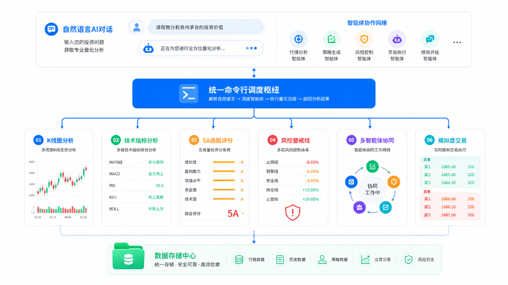
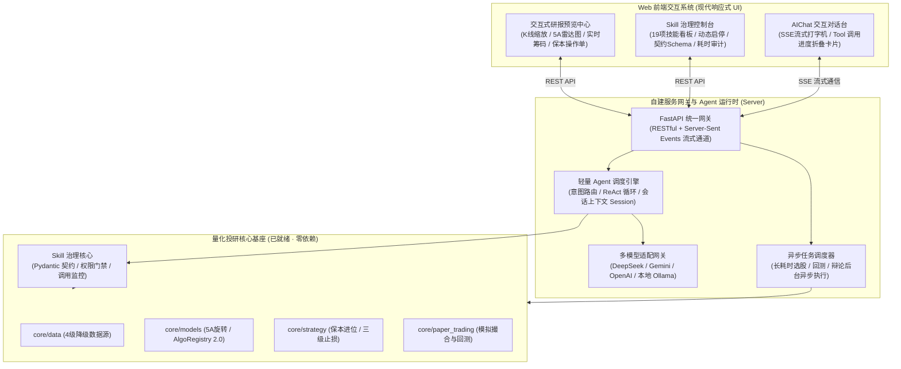

# A-Stock Agents — A股全流程量化投研智能体

## 当前工程布局与使用

唯一技能集合为`skill_bundle/`，含`skills/`（总入口+19项专业技能）、`runtime/`、公共`assets/`及`references/`。可选Web前后端位于`apps/web-console/`；根`bin/astock*`保留为薄兼容入口。

本仓库用于技能实现、测试与 Release 构建。AI工具通过发布版本使用技能，不维护打开仓库后发现技能的项目模式。

离线诊断：`python skill_bundle/runtime/doctor.py`。统一CLI：`python skill_bundle/runtime/cli.py <command> --json`。总包分发器：`python skill_bundle/runtime/run_skill.py <skill-id> --params '{"code":"600519"}' --json`。

用户配置与运行数据保存在`local/`、`output/`、`log/`、`temp/`；技能环境变量可放在`local/settings/.env`，WebUI开发配置放在`tools/containers/web-console/`。发布包不包含用户数据。Windows/macOS/Linux宿主验收分开记录。

发布归档入口为`tools/packaging/build_codex.py`、`build_hermes.py`、`build_workbuddy.py`，输出到output/packages；归档是完整集合候选快照，不作为第二套源码维护；三个平台的原生导入和全部技能发现仍须独立验收。


[](#)
[](#)
[](#)
[](#)

**A-Stock Agents** 是一套高内聚、自包含、生产就绪的 **A股全流程量化投研、多智能体协同研判与实战反应决策系统**。
项目主要以标准化 Skill Release 供 AI 工具使用；WebUI 是可选的开发调试应用。各宿主的原生导入与发现能力需分别验证，本项目暂不承诺特定宿主的专门支持。

---

## 📑 目录
- [一、架构全景图](#一架构全景图)
- [二、核心功能与 17 大智能体技能体系（6+1 分层架构）](#二核心功能与-17-大智能体技能体系61-分层架构)
- [三、环境准备与常规安装](#三环境准备与常规安装)
- [四、第三方 AI 平台与工具使用指南 (Antigravity / Hermes / Codex 等)](#四第三方-ai-平台与工具使用指南-antigravity--hermes--codex-等)
- [五、CLI 实战命令速查与使用说明](#五cli-实战命令速查与使用说明)
- [六、用户专属数据隔离 (output/)、安全打包与热更新](#六用户专属数据隔离-output-安全打包与热更新)
- [七、下一阶段演进路线：独立 Web AIChatUI 与 Skill 治理系统](#七下一阶段演进路线独立-web-aichatui-与-skill-治理系统)
- [八、项目技术文档体系](#八项目技术文档体系)
- [九、免责声明](#九免责声明)

---

## 一、架构全景图

<div align="center">
  
</div>

---

## 二、核心功能与 17 大智能体技能体系（6+1 分层架构）

### 1. 七大量化与投研核心子系统
1. **4 级自动降级数据桥接 (`core/data`)**：
   - **L1 腾讯直连**：`qt.gtimg.cn` 毫秒级原生行情与日K线，零外部复杂库依赖。
   - **L2/L3 东财与新浪财经**：提供资金流向、行业板块分布、个股事件与历史复权数据。
   - **L4 本地离线缓存**：断网或源站故障时自动切换至本地缓存，确保服务高可用。
2. **零编译经典技术指标引擎 (`core/indicators`)**：
   - 纯 Python/NumPy 实现全套技术指标：MA（5/10/20/60/120/250）、MACD、KDJ、RSI、BOLL、ATR、跳空缺口分析。
   - **波段级 MACD 底背离与水下二次金叉识别**：增加波段最小间隔过滤与波谷极值（Local Minima）对比，剔除震荡毛刺。
   - **换手率沉淀筹码模型 (Volume-by-Price)**：基于真实/估算换手率迭代衰减计算存量筹码分布加权成本与获利盘比例。
3. **5A 多维共振旋转选股与多因子模型 (`core/models`)**：
   - 结合动量、估值、质量、量价结构、主线轮动 5 个维度进行 100 分制综合打分。
   - 包含舆情因子指数半衰期衰减、MAD 去极值与 Z-Score 截面 Rank 因子合成流水线。
   - **市场机制自适应加权**：支持牛市（BULL）、震荡轮动（OSCILLATION）、熊市超跌（BEAR）专属权重模式及基于滚动 IC 的动态自适应加权。
4. **实战交易反应动作与保本价进位引擎 (`core/strategy`)**：
   - **精确最低保本卖出价**：严格计入卖出印花税（0.05%）、券商佣金（万2.5且最低5元起收）、过户费，并**强制向上精确进位至分位（`math.ceil`）**，杜绝四舍五入导致的隐性亏损。
   - **三级风控止损线**：T0 警戒线（-3%）、T1 减仓线（-5%）、T2 绝杀线（-8%）。
   - **三场景即时动作单**：开盘冲高、盘中窄幅震荡、盘中急跌跳水场景化指令。
5. **7 大 AI 分析师多智能体协同辩论 (`core/multi_agent`)**：
   - 包含基本面、量价、消息舆情、宏观政策、游资情绪、筹码分布、首席风控官 7 大角色。
   - 展开多轮多空对抗辩论并生成决议报告。
6. **模拟盘撮合交易与事件驱动回测 (`core/paper_trading`)**：
   - 多账户独立资金管理、限价单/市价单撮合、撤单、A股 T+1 交易规则与涨跌停限制撮合。
   - **平方根市场冲击滑点模型**：集成 Almgren-Chriss 理论，依据订单规模占日成交量比例自适应计算大额冲击滑点。
7. **统一算法注册中心与全生命周期治理体系 (`core/models` · `AlgoRegistry 2.0` / ALCM)**：
   - **40+ 项算法资产全量纳管**：涵盖基础指标、形态因子、多维评分模型、交易策略、仓位风控、撮合与绩效度量 7 大族群，双轨支持函数直接调用与类工厂实例化，100% 完全向下兼容。
   - **四道全生命周期质量门禁 (`AlgorithmQualityGate`)**：
     - **G1 研发合规门禁**：静态 AST 扫描 + 动态时序扰动探针（`LookaheadGuard`，彻底排查未来函数泄漏）；A股 T+1 规则、一字板涨跌停封死买卖违规与停牌撮合硬约束审计（`AShareComplianceGuard`）。
     - **G2 效能防过拟合门禁**：样本外表现衰减率检验（OOS Decay $\le 35\%$）与 Marcos López de Prado 经典的 Deflated Sharpe Ratio (DSR) 虚假夏普校准（`OverfittingGuard`）。
   - **生产监控与智能自适应调度**：
     - **`AlphaDecayTracker`**：横截面 Spearman Rank IC 滚动跟踪、IC_IR 与 Alpha 衰减预警。
     - **`RegimeAdaptiveDispatcher`**：联动大盘牛/熊/震荡机制，自适应切换因子合成权重、主力策略路由与组合仓位上限（85% / 50% / 20%）。
     - **`AlgorithmLifecycleManager`**：全生命周期状态流转机与实盘最大回撤超预期自动退市熔断器。

---

### 2. 19 个标准化 Agent 技能清单 (6+1 现代分层架构)

| 技能 ID | 技能名称 | 分层 | 核心能力描述 | CLI 快速入口 |
| :--- | :--- | :---: | :--- | :--- |
| **`astock-data-feed`** | A股全链路行情数据引擎 | L1 数据 | 实时行情快照、历史K线、全套技术指标、筹码分布与板块资金流 | `astock data quote <代码>` |
| **`astock-platform-evaluate`** | 统一A股全流程投研平台 | L1 平台 | 4层降级、100分制综合评分、被套解套策略诊断、大盘健康度评估 | `astock evaluate <代码>` |
| **`astock-screener-5a`** | 5A多维共振旋转选股 | L2 选股 | 动量/价值/质量/主线旋转多维评分模型与滚动样本外回测检验 | `astock screen 5a` |
| **`astock-quant-engine`** | 工业级量化工程引擎 | L2 量化 | 截面因子提取、换手沉淀筹码模型、牛熊自适应加权、MAD去极值、凯利仓位与ATR止损 | `astock quant pipeline` |
| **`astock-model-validation`** | 时序AI模型实证检验 | L2 验证 | 外部时序 AI 基础模型（如 Kronos/TimesFM）滚动样本外回测规范 | `astock validate-model` |
| **`astock-action-execution`** | 实战反应动作与保本价 | L3 执行 | 最低保本卖出价精确进位、T0/T1/T2三级止损与三场景即时反应指令 | `astock action plan` |
| **`astock-strategy-mainboard`** | 主板流动性池多波段防御 | L3 策略 | 主板流动性池趋势回踩（trend_pullback）与波段防守反击决策 | `astock strategy swing` |
| **`astock-strategy-tuige`** | 退哥短线交易规则体系 | L3 策略 | 涨停回调、连板接力、洗盘突破、失效卖点与仓位纪律规则库 | `astock shortline check` |
| **`astock-strategy-macd`** | 水下二次金叉与底背离 | L3 策略 | 波谷极值对比、波段间距过滤、水下二次金叉、双底回踩、MACD底背离形态识别 | `astock pattern macd <代码>` |
| **`astock-pool-dashboard`** | 投研面板与股池管理 | L4 面板 | 关注池/自选池/持仓池生命周期管理、通达信公式同步、盘中预警 | `astock pool list` |
| **`astock-pool-audit`** | 三大股池统一审查 | L4 股池 | 统一审查股池、重算均线支撑阻力位、清洗过期失效标的 | `astock pool audit` |
| **`astock-trade-paper`** | 模拟盘与撮合系统 | L4 交易 | 多账户模拟仓、平方根市场冲击滑点、限价/市价单撮合、撤单与回测 | `astock trade balance` |
| **`astock-agent-debate`** | 7大AI分析师多空辩论 | L5 协同 | 基本面/量价/消息/政策/游资/筹码/风控 7 大智能体辩论与研报 | `astock debate <代码>` |
| **`astock-report-html`** | 标准HTML交互报告规范 | L6 展现 | 亚光白背景、红涨绿跌、1344px居中单文件自包含 HTML 报告样式 | `astock report html` |
| **`astock-report-archive`** | 报告持久化与归档规范 | L6 报告 | 多股联合报告输出路径规范与数据持久化存储结构标准 | `astock report generate` |
| **`astock-meta-routing`** | 股票任务模型路由规则 | L0 元系统 | flash纯分析 vs flash+execute_code编程/脚本执行路由规约 | `astock tips` |
| **`astock-knowledge-tips`** | 避坑指南与实战技巧 | L0 知识 | 早盘竞价复盘、接口被封应对、数据源降级策略与历史经验技巧库 | `astock tips` |

---

## 三、环境准备与常规安装

### 1. Linux / macOS
```bash
# 进入项目目录
cd a_stock_agents

# 赋予执行权限并一键安装 (自动初始化虚拟环境、依赖、离线结构自检)
chmod +x tools/development/setup.sh tools/development/run-web.sh bin/astock
./tools/development/setup.sh

# 一键启动项目 (Web 智能工作台 + API 统一网关)
./tools/development/run-web.sh

# 手动运行 11/11 项全功能自动化自检
python skill_bundle/runtime/doctor.py
```

### 2. Windows (PowerShell / CMD)
```powershell
# 进入项目目录
cd a_stock_agents

# 初始化开发环境（依赖及离线诊断，不注册技能）
.\tools/development/setup.ps1

# 一键启动项目 (Web 智能工作台 + API 统一网关)
.\tools/development/run-web.ps1
# (Git Bash / WSL 用户可运行 ./tools/development/run-web.sh)

# 手动运行自检
python skill_bundle/runtime/doctor.py
```

### 3. 可选 Docker Web 调试环境

开发调试可使用Docker隔离Web应用依赖。该环境不是技能Release安装前提；使用已存在镜像时禁止隐式构建：

```bash
# 可选：复制技能运行环境变量模板，在本地填写模型凭据
mkdir -p local/settings
if [ ! -f local/settings/.env ]; then cp skill_bundle/assets/config/runtime.env.example local/settings/.env; fi

# 初始化WebUI开发配置，不覆盖已有端口设置
if [ ! -f tools/containers/web-console/.env ]; then cp tools/containers/web-console/.env.example tools/containers/web-console/.env; fi

# 使用已存在镜像启动Web调试（首次构建需另行执行）
docker compose --env-file tools/containers/web-console/.env -f tools/containers/web-console/compose.yaml up --no-build

# 查看运行状态与健康检查
docker compose --env-file tools/containers/web-console/.env -f tools/containers/web-console/compose.yaml ps
```
> 详细运维、日志排查与容器内 CLI 调用见 [Docker 容器化部署指南](docs/docker-deploy.md)。

> [!TIP]
> **开发安装边界**：安装脚本仅初始化开发环境及诊断，不注册AI工具技能。


---

## 四、第三方 AI 平台与工具使用指南 (Antigravity / Hermes / Codex 等)

本仓库是开发工程；宿主使用 Release。开发者先执行 P0 和产物闭包验证，再按目标平台格式完成实际安装、发现和调用验收。

```bash
python tools/packaging/build_codex.py --json
python tools/packaging/build_hermes.py --json
python tools/packaging/build_workbuddy.py --json
```

当前输出为完整集合候选 ZIP，不能据此宣称客户端直接导入兼容。20个标准入口与19项业务能力分别计数；只发现总入口的宿主记1个入口。安装版本不携带开发私有配置，用户数据与安装缓存分离。

完整目录、平台适配和验收要求见[Release交付规范](docs/guidelines/engineering/skill-suite-portability-specification.md)。

## 五、CLI 实战命令速查与使用说明

所有 CLI 命令均原生支持 `--json` 参数，便于智能体程序反序列化解析。

### 0. 7 大 AI 分析师多空辩论研判 (Debate)
```bash
# 7 角色多空对抗研判、量化打分与首席风控指令 (纯文本排版)
./bin/astock debate 600519

# 结构化 JSON 输出 (供智能体程序与未来 Web UI 消费)
./bin/astock debate 600519 --json
```

### 1. 实时行情快照 (Quote)
```bash
# 查询单只股票
./bin/astock data quote 600519

# 批量查询股票 (输出 JSON)
./bin/astock data quote 600519 000858 sz002594 --json
```

### 2. 技术指标计算 (Technical Indicators)
```bash
# 计算均线、MACD、KDJ、RSI、BOLL、ATR及水下二次金叉信号
./bin/astock data tech 600519 --count 120 --json
```

### 3. 多因子量化评分与个股诊断 (Evaluate)
```bash
# 100 分制多维度综合打分诊断
./bin/astock evaluate 600519 --json
```

### 4. 反应动作单与最低保本卖出价计算 (Action Plan)
```bash
# 计算买入成本 1250 元、100 股的精确最低保本卖出价与盘中三场景动作
./bin/astock action plan --code 600519 --cost 1250.00 --shares 100 --json
```

### 5. 查看所有已注册技能 (Skills List)
```bash
./bin/astock skill list --json
```

### 6. Python 算法库与全生命周期治理 SDK 快速上手 (Python API)
项目提供现代化的 Python 算法治理与调度接口：
```python
from core.models import (
    AlgoRegistry,
    AlgorithmQualityGate,
    RegimeAdaptiveDispatcher,
    AlphaDecayTracker,
    get_algo,
    run_algo,
    list_algos,
)

# 1. 算法查询与工厂执行 (涵盖 40+ 项算法资产)
indicators = list_algos(category="indicator")
macd_fn = AlgoRegistry.get("macd")
strategy = AlgoRegistry.get("volatility_breakout")

# 2. 一键执行全生命周期质量门禁审计 (G1 合规 + G2 防过拟合)
report = AlgorithmQualityGate.audit_algorithm(
    name_or_func=strategy,
    sample_klines=sample_klines,
    trade_log=trade_records,
    in_sample_metrics=is_metrics,
    out_sample_metrics=oos_metrics,
    daily_returns=daily_returns_series,
)
print(f"门禁判定: {report.status.value}, 质控得分: {report.score}")
if not report.is_passed():
    print(f"阻断原因: {report.violations}")

# 3. 市场机制自适应调度 (牛市进攻/震荡轮动/熊市防御)
plan = RegimeAdaptiveDispatcher.dispatch("BULL")
print(f"建议总仓位: {plan.max_portfolio_weight*100}%, 主力策略: {plan.primary_strategies}")
```

---

## 六、开发源码与Release更新

开发仓库通过Git维护，保留未提交修改；不再用技能ZIP覆盖开发源码。旧update入口已退役并拒绝执行。宿主通过其受支持的Release更新机制管理安装版本，用户数据独立保留。

## 七、下一阶段演进路线：独立 Web AIChatUI 与 Skill 治理系统

为了进一步摆脱对第三方 AI 终端工具（Antigravity / Hermes / Codex）的宿主环境依赖，系统计划在下一阶段构建**自包含的 Web 版本独立交互系统**，涵盖以下三大核心子系统：

### 1. 架构演进蓝图



### 2. 三大核心能力规划
1. **全功能量化 AIChat 对话台**：
   - 内置轻量 Agent ReAct 运行时与会话存储（SQLite / DuckDB）；
   - 支持 SSE（Server-Sent Events）打字机流式响应与工具调用状态（如“正在拉取腾讯行情”、“正在计算MACD水下二次金叉”）实时折叠展开；
   - 自动映射用户意图至 17 大专业量化技能，强制输出三级风控止损与保本价进位动作。
2. **可视化 Skill 治理控制台 (Skill Governance Console)**：
   - 基于 `config/skills_manifest.json` 与 Pydantic Schema 建立技能运行时元数据管理；
   - **动态生命周期管控**：支持在 Web 界面上一键启用/停用特定技能、调整技能参数阈值；
   - **调用审计与度量中心**：统计技能调用频次、耗时分布、错误率与 Token 消耗，提供全链路调用日志回溯；
   - **分级权限与风控门禁**：对只读查询（如 quote、screen）与高危写入（如模拟下单、清空股票池）进行分级管控，支持 Human-in-the-Loop 二次确认。
3. **交互式研报预览与策略中心**：
   - 摆脱传统静态单文件 HTML，通过结构化 JSON API 驱动现代交互式可视化图表（ECharts / Lightweight-Charts）；
   - 支持 K 线周期缩放、指标动态叠加、筹码分布交互演化与股票池/持仓池拖拽管理。

---

## 八、项目技术文档体系

本项目全量文档统一遵循**知识定义（`guidelines/`）与实施进度（`specs/`）双层解耦架构**与 **`kebab-case` 小写短横线**标准化命名规范：

### 1. 规范、指南、架构与规则权威知识库 (`docs/guidelines/` - SSOT)
| 类别 | 知识库入口 | 对应实施看板 | 核心内容与定位 |
|---|---|:---:|---|
| **知识库总览** | [`docs/guidelines/README.md`](docs/guidelines/README.md) | [`docs/specs/README.md`](docs/specs/README.md) | 全景分类矩阵（规范·指南·架构·规则）与演进规约 |
| **工程规范** | [`docs/guidelines/engineering/project-structure-specification.md`](docs/guidelines/engineering/project-structure-specification.md) | [`SPEC-ENG-001`](docs/specs/engineering/eng-project-structure-and-workspace.md) | 零全局污染、SSOT、跨平台 CLI 门面与数据隔离规范 |
| **A2UI规范** | [`docs/guidelines/a2ui/a2ui-component-registry-specification.md`](docs/guidelines/a2ui/a2ui-component-registry-specification.md) | [`SPEC-A2UI-002`](docs/specs/a2ui/a2ui-component-registry-specification.md) | A2UI 组件包契约、时序解耦未决队列与自省清单规范 |
| **界面指南** | [`docs/guidelines/ui/ui-design-guide.md`](docs/guidelines/ui/ui-design-guide.md) | [`SPEC-UI-001`](docs/specs/ui/ui-design-and-interaction-specification.md) | 浅色金融风格、红涨绿跌、双模视口与卡片轻量边框指南 |
| **算法治理** | [`docs/guidelines/algorithm/algorithm-governance.md`](docs/guidelines/algorithm/algorithm-governance.md) | [`SPEC-ALGO-001`](docs/specs/algorithm/algo-lifecycle-and-governance-specification.md) | 44 项量化算法全景清单、AlgoRegistry 2.0 与四道质量门禁 |
| **代码审查** | [`docs/guidelines/engineering/code-review.md`](docs/guidelines/engineering/code-review.md) | - | 代码质量基准、安全红线与质量审查报告标准 |
| **测试规约** | [`docs/guidelines/engineering/testing-guide.md`](docs/guidelines/engineering/testing-guide.md) | - | 10 大核心领域回归测试架构与临时用例即测即删铁律 |
| **命名范式** | [`docs/guidelines/engineering/naming-conventions.md`](docs/guidelines/engineering/naming-conventions.md) | - | 消除文件名版本化侵入与模型演进四大设计范式 (SSOT) |
| **系统架构** | [`docs/guidelines/architecture/web-aichat-architecture.md`](docs/guidelines/architecture/web-aichat-architecture.md) | [`SPEC-ARCH-001`](docs/specs/architecture/arch-web-aichat-and-skill-governance.md) | 独立 Web AIChatUI、FastAPI 服务网关与 18 技能治理架构 |
| **系统架构** | [`docs/guidelines/architecture/llm-provider-architecture.md`](docs/guidelines/architecture/llm-provider-architecture.md) | [`SPEC-ARCH-002`](docs/specs/architecture/arch-llm-provider-and-role-allocation.md) | 大模型双轨接入 (Providers) 与业务场景角色绑定 (Roles) 架构 |
| **系统架构** | [`docs/guidelines/architecture/token-security-architecture.md`](docs/guidelines/architecture/token-security-architecture.md) | [`SPEC-ARCH-003`](docs/specs/architecture/arch-token-security-gateway.md) | Token 链路安全网关、控制平面隔离与指纹审计架构 |
| **A2UI架构** | [`docs/guidelines/a2ui/a2ui-framework-architecture.md`](docs/guidelines/a2ui/a2ui-framework-architecture.md) | [`SPEC-A2UI-001`](docs/specs/a2ui/a2ui-framework-engine-specification.md) | A2UI 前端渲染引擎、WebApp Shell 硬锁定与五阶段渐进水合 |
| **业务规则** | [`docs/guidelines/business/breakeven-calculation-rules.md`](docs/guidelines/business/breakeven-calculation-rules.md) | [`SPEC-BIZ-002`](docs/specs/business/biz-breakeven-price-calculation-rules.md) | 最低保本卖出价精算公式与向上进位至分位 (`math.ceil`) 规则 |
| **业务规则** | [`docs/guidelines/business/broker-commission-rules.md`](docs/guidelines/business/broker-commission-rules.md) | [`SPEC-BIZ-001`](docs/specs/business/biz-broker-commission-configurable-design.md) | 券商佣金及市场费率配置化、动态热重载与未配置友好提示 |
| **业务规则** | [`docs/guidelines/business/trading-execution-rules.md`](docs/guidelines/business/trading-execution-rules.md) | [`SPEC-BIZ-003`](docs/specs/business/biz-trading-execution-and-risk-control.md) | 实战交易三原则、六大交易反应动作与 T0/T1/T2 止损阶梯 |

### 2. 规范实施进度看板与实战索引
| 领域分类 | 入口文件 | 核心说明 |
|---|---|---|
| **知识速查全景** | [`docs/index.md`](docs/index.md) | 系统导图、6大引擎与 18 技能架构速查 |
| **快速上手向导** | [`docs/quickstart.md`](docs/quickstart.md) | 环境安装、依赖配置、自检与核心命令演示 |
| **规范实施总览** | [`docs/specs/README.md`](docs/specs/README.md) | 6 大领域规范实施落地进度追踪总看板 (SPEC-INDEX) |
| **实战交易手册** | [`docs/trading/execution-manual.md`](docs/trading/execution-manual.md) | 六大实战反应动作与挂单纪律实操指南 |
| **保本精算速查** | [`docs/trading/breakeven-rules.md`](docs/trading/breakeven-rules.md) | 最低保本卖出价精算数学公式与进位速查表 |

---

## 九、免责声明

1. 本项目所提供的所有量化算法、技术指标、5A 选股模型、实战决策建议及多智能体研判结论，**仅供金融投研学习、量化策略研究与技术验证使用，不构成任何实质性投资建议或交易推荐**。
2. 证券市场有风险，投资决策需建立在独立思考与专业判断之上。用户依据本项目提供的数据、策略或模型进行的任何实盘交易操作，其盈亏风险由使用者自行完全承担。

