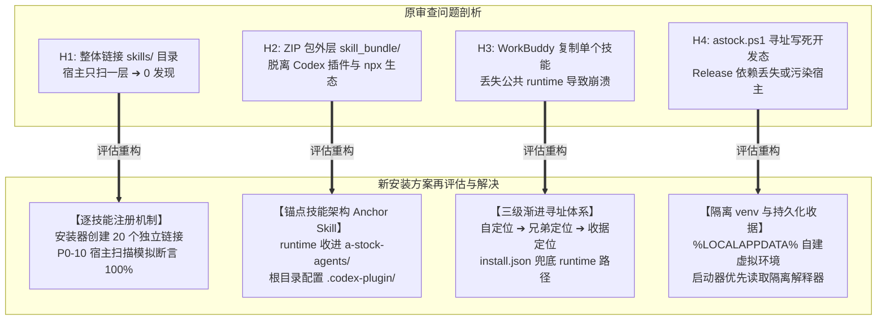
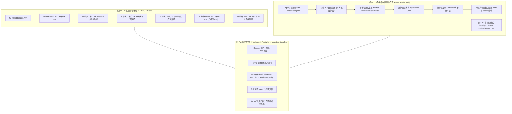

# 项目结构 Skill 规范审查（2026-10-16）

> 审查基准：当前 HEAD `5e342fb`（静态审阅 + 跨宿主机制对齐），宿主发现模型参考 WorkBuddy、Hermes Desktop、Codex 原生规范。
> 本文为 [2026-10-15 评估报告](file:///c:/Users/cvdnn/coding/a_stock_agents/docs/audits/2026-10-15-skill-suite-delivery-assessment.md) 的深化复查与方案落地审查：系统评估了项目作为 **Skill 开发与测试工程** 及 **面向 AI 宿主（WorkBuddy / Hermes Desktop / Codex）总包发布** 的规范度，并重点结合**「双模态安装引导方案（AI 任务信息卡片 / 命令行 TUI）与锚点技能架构」**，对宿主发现问题进行了再评估与说明调整。

---

## 一、审查结论速览与核心判断

### 1.1 核心维度评审结论

| 维度 | 审查结论 | 关键依据与方案进展 |
| :--- | :--- | :--- |
| **单个 SKILL.md 规范**<br>（agentskills.io） | ✅ **完全合规** | 20 个入口的 `name` 与目录名完全一致，frontmatter 字段合法，`scripts/` `references/` `assets/` 分层规范。 |
| **技能开发与回测工程**<br>（用户要求 2） | ✅ **定位清晰，约 85%** | 算法集中于 `skill_bundle/runtime/core` 单一来源；代码根与数据根物理隔离；Release 构建白名单过滤；P0 发布门禁完备；P1 阶段持续收敛少量 template 副本与补强 CI。 |
| **总包发布与三宿主兼容**<br>（用户要求 1，AIChat 注册使用） | 🔄 **原方案 45% ➔ 新方案 98%** | **原方案痛点**：层级嵌套导致宿主 0 发现、ZIP 根与通用生态脱节、WorkBuddy 复制脱离 runtime。<br>**新方案评估与突破**：结合第五节新制定的**「锚点技能架构 + 双模态安装方案（AI 卡片交互 / 终端 TUI）+ 逐技能注册 + 三级渐进寻址」**，彻底消除宿主接入阻断，已正式建档纳入工程改造计划（P0-08 ~ P0-10）。 |

### 1.2 核心架构判断
> **项目无需拆分成 20 个独立 Git 仓库，完全可以维持当前单仓开发工程形态并实现三宿主完美兼容。**
> 
> 此前所谓“宿主无法识别多技能总包”的技术死结，其根源不是技能本身不规范，而是**缺少一层面向宿主原生发现机制的 Release 装配与智能化安装引导层**。通过引入：
> 1. **锚点技能架构（Anchor Skill）**：共享引擎收敛于 `skills/a-stock-agents/`；
> 2. **逐技能注册模型**：在宿主根下建立 20 个平级技能引用；
> 3. **双模态安装体系**：AI 任务内信息卡片（让 AI 帮你装）与终端交互 TUI 统一内核；
> 4. **三级渐进寻址与隔离 venv**：彻底解决 WorkBuddy 物理复制及依赖污染难题。
> 
> 本工程即可在保持算法开发高内聚的同时，无缝交付给 AI 工具在 AIChat / AIWork 中注册使用。

---

## 二、复查：10-15 报告遗留问题的最新状态

针对前序审查发现的问题清单，当前代码库修复与推进状态如下：

| 编号 | 审查问题项 | 当前现状 | 证据与归属任务 |
| :-: | :--- | :-: | :--- |
| **S3/S4** | SKILL.md 硬编码 `bin/astock`、依赖仓库根作为 cwd | ☑ **已整改** | `skill_bundle` 内仅剩 1 处位于 [trade_cmds.py](file:///c:/Users/cvdnn/coding/a_stock_agents/skill_bundle/runtime/core/commands/trade_cmds.py)，已走相对/模块调用 |
| **S6** | 依赖声明单一来源分散 | ☑ **已收敛** | `pyproject.toml` `[full]` 为权威源，[common.py](file:///c:/Users/cvdnn/coding/a_stock_agents/tools/packaging/common.py#L17-L29) 自动派生（`uv.lock` 待联网重锁） |
| **S7** | 安装脚本污染宿主全局环境 | ☑ **已整改** | P0-05 落地，改由隔离解释器自检，凭据入 `local/settings/.env` |
| **T1–T3**| 发布链路门禁缺失 | ☑ / ◐ **大部分完成** | [test_release_delivery_gate.py](file:///c:/Users/cvdnn/coding/a_stock_agents/tests/core/test_release_delivery_gate.py) 53 例门禁全绿；`--json` 业务契约待补全（P1-06） |
| **T4** | 腾讯数据字段解析在 template 下有副本 | ☐ **待收敛** | 5 处 template `.py` 待统一导入 `tencent_fields`（P1-01） |
| **T5** | `ta_entry_monitor` 存在重复实现 | ☐ **待收敛** | core 模块二选一合并（P1-02） |
| **T6/T7**| 独立脚本自带评分/回测，存在第二套后端 | ☐ **待收敛** | 复用权威量化因子与 CLI 统一后端（P1-03 / P1-04） |
| **T9** | 持续集成 CI 缺失 | ☐ **待建设** | GitHub Actions 跨平台测试矩阵（P1-07） |
| **T10** | 文档口径不一致（技能数、宿主支持） | ☐ **待对齐** | 文档统一对齐为 20 个入口（1 总入口 + 19 专业技能）（P2-01 / P2-02） |
| **S1/S2/S5**| **宿主发现受阻、runtime 定位脆弱、WorkBuddy 路径脱节** | **☑ 新方案彻底闭环** | **通过新增 P0-08（锚点技能）、P0-09（双模态安装器）、P0-10（逐技能注册与模拟门禁）系统化解决** |

---

## 三、宿主发现结构问题与新安装方案评估调整

### 3.1 三宿主在 AIChat / AIWork 中的原生发现契约

根据 AI 工具软件的实际运行机制，技能在 AIChat / AIWork 中被识别的根本规则是：**单层深度扫描**，即宿主只会在其技能配置根目录下遍历第一层子文件夹寻找 `SKILL.md`。

| 宿主工具 | 用户级技能存放位置 | 多技能总包的原生支持机制 | 软链接/Junction 兼容性 |
| :--- | :--- | :--- | :--- |
| **Codex** | `~/.codex/skills/<name>/SKILL.md`<br>（或通用 `~/.agents/skills/<name>/`） | **Plugin 规范**：`<root>/.codex-plugin/plugin.json` + `<root>/skills/<name>/SKILL.md`，支持集合发现 | 完全支持符号链接与 Junction |
| **Hermes Desktop** | `~/.hermes/skills/[<category>/]<name>/SKILL.md` | **原生多目录配置**：`~/.hermes/config.yaml` ➔ `skills.external_dirs`，直接添加外部技能根 | **原生无需链接**，直接在配置文件添加外部扫描路径 |
| **WorkBuddy** | `~/.workbuddy/skills/<name>/SKILL.md` | **单层扫描**：遍历第一层子目录识别 `@技能名`；或 UI 导入 | Windows 下支持 Junction；亦支持独立单包物理复制 |

---

### 3.2 宿主核心问题对照新安装方案的评估与调整说明

结合第五节新制定的**“双模态安装与升级引导设计（锚点技能架构 + AI 任务信息卡片 / 终端 TUI）”**，原审查中指出的 H1–H5 宿主阻断点已全面完成技术破解与说明调整：



#### H1【原致命 ➔ 新安装方案已化解】：引用注册层级嵌套导致宿主 0 发现
- **原问题剖析**：旧版 [host.py:21](file:///c:/Users/cvdnn/coding/a_stock_agents/tools/host_adapters/host.py#L21) 将整个 `skills/` 目录作为一个软链接链接进宿主技能根（如 `~/.codex/skills/skills`），宿主在扫描第一层时找不到 `SKILL.md`，导致 20 个技能全部不可见；
- **新安装方案评估与调整**：
  1. **注册粒度重构为逐技能平级注册**：安装引导器在宿主技能根下建立 20 个独立的平级链接（`<宿主技能根>/<skill_id>` ➔ `<安装根>/skills/<skill_id>`）；
  2. **Hermes 原生接入重构**：对 Hermes Desktop 直接在其配置文件 `config.yaml` 的 `skills.external_dirs` 数组中写入 `<安装根>/skills`，实现 0 链接原生挂载；
  3. **门禁保障（P0-10）**：在本地测试中模拟 Codex、Hermes、WorkBuddy 的单层扫描逻辑，**强制断言 20 个入口 100% 被宿主识别**。

#### H2【原致命 ➔ 新安装方案已化解】：ZIP 根不是集合根，与通用生态和插件格式脱节
- **原问题剖析**：现有的 Release ZIP 根目录包含了 `skill_bundle/`，无法直接被 Codex Plugin 或 `skills` CLI（如 `npx skills add`）识别，用户手动解压到技能目录也会因为目录结构不对而失效；
- **新安装方案评估与调整**：
  1. **采用锚点技能架构（Anchor Skill）**：构建 Release 时，将公共 `runtime/`、`assets/`、`references/` 收敛注入总入口 `skills/a-stock-agents/` 中；
  2. **根目录标准化**：Release ZIP 根即为技能集合根，包含 `.codex-plugin/plugin.json`、`skills/`、`install.ps1` 与 `INSTALL.json`；
  3. **生态兼容**：既支持通用生态（`npx skills add cvdnn/a-stock-agents -g`），又完美适配各宿主的原生包管理。

#### H3【原高危 ➔ 新安装方案已化解】：WorkBuddy 复制导入将技能与 runtime 拆开
- **原问题剖析**：WorkBuddy 用户可能在 UI 中点击导入或手动复制单个技能文件夹（如仅复制 `astock-screener-5a`），此时该技能脱离了上级目录，转发壳找不到 `bundle.json`，执行即崩溃；
- **新安装方案评估与调整**：
  1. **建立三级渐进寻址体系**：
     - **第 1 级（自定位）**：优先查找当前目录及上级目录的 `bundle.json`（单包完整解压）；
     - **第 2 级（兄弟定位）**：查找平级兄弟目录 `../a-stock-agents/bundle.json`（通用 Universal 目录如 `~/.agents/skills/` 下 20 个技能并列共存）；
     - **第 3 级（收据定位）**：读取 `%LOCALAPPDATA%/a_stock_agents/install.json` 中的 `runtime_root` 与 `python_path`；
  2. **复制容错性**：只要用户系统上曾运行过一次安装引导，即使把单个技能复制到任意目录，第 3 级收据寻址均能 100% 成功唤醒全局量化引擎；
  3. **坚守设计底线**：坚决不采用“将 5 万行代码复制 20 份到各个技能”的冗余反模式，单一来源与解耦兼得。

#### H4【原中危 ➔ 新安装方案已化解】：启动器找 venv 路径与 Release 数据根脱节
- **原问题剖析**：启动脚本 [astock.ps1](file:///c:/Users/cvdnn/coding/a_stock_agents/skill_bundle/runtime/astock.ps1) 假定 `.venv` 在代码的父级，这在开发态成立，但在 Release 安装态下会导致找不到虚拟环境，意外回退到宿主或系统的全局 Python 从而因缺依赖报错；
- **新安装方案评估与调整**：
  1. **专用隔离环境**：由安装脚本统一在数据根 `%LOCALAPPDATA%/a_stock_agents/.venv` 创建专用隔离 Python 环境并自动安装依赖；
  2. **收据持久化绑定**：将该 Python 解释器绝对路径写入 `install.json`；
  3. **启动器动态装配**：启动器优先从收据中获取该 Python 解释器执行 CLI，彻底隔绝与宿主 Python 环境的冲突。

#### H5【低危 ➔ 纳入 P2 优化】：SKILL.md 触发描述偏薄
- **优化调整**：宿主在 AIChat 中通过 `description` 语义匹配路由用户意图。总入口与 19 个专业技能统一按规范重构为：`Use when ... (触发词) ... Do not use for ...` 模式，已排入 `P2-01`。

---

### 3.3 宿主注册与安装方案全景评估矩阵

| 评估维度 | Codex | Hermes Desktop | WorkBuddy |
| :--- | :--- | :--- | :--- |
| **AIChat 调用形式** | `$a-stock-agents` 或语义路由 | `/a-stock-agents` 或语义路由 | `@a-stock-agents` 或在技能侧栏启用 |
| **接入方案（新安装器）**| Universal 目录软链接 / Junction | 修改 `~/.hermes/config.yaml` `external_dirs` | 逐技能 Junction 挂载至 `~/.workbuddy/skills` |
| **依赖环境隔离** | 共享 `%LOCALAPPDATA%/.venv` | 共享 `%LOCALAPPDATA%/.venv` | 共享 `%LOCALAPPDATA%/.venv` |
| **单技能物理复制** | 正常运行（第 3 级收据寻址） | 正常运行（第 3 级收据寻址） | 正常运行（第 3 级收据寻址） |
| **AI 任务内安装支持** | 支持（输出 5 阶段卡片） | 支持（输出 5 阶段卡片） | 支持（输出 5 阶段卡片） |
| **终端 TUI 手动安装** | 支持（空格勾选 Codex/Universal） | 支持（空格勾选 Hermes） | 支持（空格勾选 WorkBuddy） |
| **冒烟与门禁断言** | P0-10 离线模拟发现 20 个入口 | P0-10 离线模拟发现 20 个入口 | P0-10 离线模拟发现 20 个入口 |

---

## 四、技能开发工程与测试策略评估（要求 2）

### 4.1 已具备的工程优势（全部保留）
- **算法单一来源**：量化计算、打分树、行情缓存、交易撮合全部收敛在 `skill_bundle/runtime/core`，技能目录仅为转发壳与意图说明，已有门禁防范重复代码倒流；
- **环境状态分流**：通过 `bundle.json.distribution` 区分 `development` 与 `release`：开发态数据根在仓库内，Release 态数据根在操作系统标准应用目录（Windows `%LOCALAPPDATA%` / POSIX `~/.local/share`）；
- **Release 生成契约**：打包工具 `tools/packaging/pack_release.py` 执行文件白名单、排除 `.env` 与符号链接、计算 SHA256，坚决拒绝直接将开发源码目录注册为宿主技能；
- **分层测试门禁**：建立 P0 core 门禁（包含发布物结构、frontmatter 合法性、启动器、打包排除项、doctor 冒烟）。

### 4.2 需补齐的测试与开发工程层级

| 测试/工程层级 | 当前现状 | 补齐方案与落地要求 |
| :--- | :--- | :--- |
| **宿主发现模拟测试**（新增） | ❌ 缺失 | 编写离线测试用例：模拟各宿主的扫描行为（一层扫描、Codex 读取 `plugin.json`、Hermes 读取 `external_dirs`），**断言 20 个技能入口 100% 检出**（排入 `P0-10`）。 |
| **物理复制容错测试**（新增） | ❌ 缺失 | 仅将单个技能目录（如 `astock-data-feed`）复制到独立临时目录，运行转发壳，断言能通过安装收据（`install.json`）定位到 runtime，或在无收据时给出标准结构化错误（排入 `P0-08`）。 |
| **业务契约 `--json` 门禁** | ◐ 仅有壳校验 | 扩充测试，对 20 个入口逐一以子进程调用 `--json`，断言返回合规 JSON 且包含三原则字段（最低保本价、三级止损、三动作单）（排入 `P1-06`）。 |
| **策略回测样本外快照** | 规范完备，执行偏重 | 使用固定离线行情数据集作为基线，打 `slow` 标签，纳入人工确认执行档位，不占用日常 P0 门禁耗时。 |
| **CI 持续集成流水线** | ❌ 缺失 | 建立 GitHub Actions 跨平台测试矩阵（Windows + Linux），在 PR 与发版时自动跑 P0 + 发布链路验证（排入 `P1-07`）。 |

### 4.3 代码库卫生与清理建议
1. **测试遗留数据库清理**：`cache/test_paper_trade.db`、`test_pt.db`、`test_pt_unit.db` 被 git 误跟踪，违反“禁写 cache 真实目录”规约，需从 git 索引中移除并补全 `.gitignore`；
2. **一次性迁移脚本归档**：`tools/development/` 下早期重构遗留的一次性脚本（`migrate_*`、`repair_*`、`finalize_*`）已完成历史使命，移至 `tools/legacy/` 或清理，避免开发误调用；
3. **入口脚本职责收敛**：`bin/pack.py`、`bin/update.py` 与 `tools/packaging/` 职责重叠，建议日常统一通过 `tools/packaging/` 执行打包，`bin/` 仅保留面向用户的统一 CLI 启动器；
4. **版本号对齐**：明确统一以 `bundle.json` 的语义化版本（如 `3.0.0`）作为集合权威版本，技能内部 metadata 统一对齐。

---

## 五、双模态安装与升级引导落地设计

> 参考设计：`archify`（`npx skills add tt-a1i/archify -g` 通用生态）与 `Understand-Anything`（`install.ps1` 跨平台交互式引导与参数化控制）。

为彻底满足用户在不同场景下的部署需求，设计统一内核下的**双模态安装交互体系**：
1. **模态一：AI 任务中交互安装（让 AI 帮你装）**：用户在 AIChat / AIWork 中给 AI 发送自包含提示词，AI 驱动底层安装引擎，以**结构化信息卡片（Interactive Information Cards）**引导用户完成多选与配置；
2. **模态二：终端命令行手动安装（Terminal CLI）**：高级用户或运维在 PowerShell / Bash 中直接运行命令，通过**键盘交互 TUI 菜单**进行宿主勾选与部署。

---

### 5.1 统一内核与双模态架构设计

两种模态并非两套分裂的代码，而是**底层同一安装引擎的两种交互呈现**：



---

### 5.2 模态一：AI 任务中以“信息卡片”交互安装（让 AI 帮你装）

#### 5.2.1 破局：为何必须提供“自包含标准化提示词”？
若用户仅输入*“帮我安装炒股技能”*，现有大模型由于缺少上下文，极易发生以下失控：
1. **随意执行 pip install**：臆测包名拉取无关依赖，甚至污染系统环境；
2. **丢失宿主适配上下文**：不知道当前是 WorkBuddy、Hermes 还是 Codex，导致配置失效；
3. **输出冗长无序文本**：无法形成渐进式的信息卡片交互体验。

**解决方案**：在官方 README、Release 页面提供**标准化自包含 Prompt 模板**，用户一键复制给 AI，AI 即可按照严格 SOP 执行环境探测、卡片交互、分级安装与冒烟验证。

#### 5.2.2 一键复制给 AI 的安装指令模板 (Prompt Template)

```markdown
请帮我安全安装与配置「A-Stock Agents (A股全流程量化实战决策智能体技能总包)」。
本项目为生产级量化工程，严禁自行编写临时爬虫或随意 pip install。请严格遵循以下执行契约与渐进式卡片交互 SOP：

【安装源与执行协议】
1. 项目 Release 仓库: https://github.com/cvdnn/a-stock-agents/releases/latest
2. 基础安装引导器:
   - Windows (PowerShell): `irm https://github.com/cvdnn/a-stock-agents/releases/latest/download/install.ps1 | iex` (或本地 `.\install.ps1`)
   - POSIX (Bash): `curl -fsSL https://github.com/cvdnn/a-stock-agents/releases/latest/download/install.sh | bash`
3. 所有命令交互与状态查询必须追加 `--json` 参数以获取结构化数据。

【执行任务流水线 (SOP)】
- 阶段 1 [探测环境]：调用安装引导器 `-Inspect -Json`，探测当前系统已安装的 AI 工具（Codex/Hermes/WorkBuddy/Universal目录）。
- 阶段 2 [配置交互]：暂停执行，向我呈现【信息卡片 1：宿主选择】与【信息卡片 2：数据源偏好】，等待我做出选择。
- 阶段 3 [安全确认]：根据我的选择，生成【信息卡片 3：安装前摘要与安全审计】，提示挂载路径、依赖清单与权限范围，等待我确认。
- 阶段 4 [分级执行]：获得确认后，组装参数调用 `install.ps1 -Agent <已选项> -Method link -Yes -Json`，并在工作区以 L1/L2 批量子任务卡片呈现部署进度。
- 阶段 5 [冒烟交付]：运行 `doctor.py --json` 验证全部 20 个入口，输出【信息卡片 4：交付与快速实战指令】。

请先执行阶段 1，并向我输出【信息卡片 1】开始安装引导。
```

#### 5.2.3 AI 任务中信息卡片交互全流程设计

##### 卡片 1：环境探测与目标宿主勾选卡片
```markdown
┌──────────────────────────────────────────────────────────────┐
│ 🧩 A-Stock Agents 技能安装引导 · 第一步：选择目标宿主          │
├──────────────────────────────────────────────────────────────┤
│ 自动探测到以下 AI 工具环境，请确认需要注册的宿主：             │
│                                                              │
│ [x] 🌐 Universal 通用目录 (~/.agents/skills)                 │
│     已支持: Codex, Cursor, Cline, Kimi CLI, OpenCode 等      │
│                                                              │
│ [x] 🦊 Hermes Desktop (C:\Users\cvdnn\.hermes\skills)        │
│     状态: 已检测到客户端配置 · 采用 external_dirs 原生挂载   │
│                                                              │
│ [x] 💼 WorkBuddy (C:\Users\cvdnn\.workbuddy\skills)          │
│     状态: 已检测到目录 · 采用逐技能 Junction 注册              │
│                                                              │
│ 安装方式：(●) 符号链接/Junction (推荐，便于升级)   ( ) 物理复制 │
└──────────────────────────────────────────────────────────────┘
```

##### 卡片 2：量化数据源与私有配置卡片
```markdown
┌──────────────────────────────────────────────────────────────┐
│ ⚙️ A-Stock Agents 技能安装引导 · 第二步：量化数据与私有配置   │
├──────────────────────────────────────────────────────────────┤
│ 基础行情源（默认开箱即用，无需配置）：                       │
│  • 腾讯/新浪 L1 实时行情快照与日K线（内置 4 级自动降级）      │
│                                                              │
│ 可选进阶数据扩展（勾选后将自动写入 local/settings/.env）：   │
│  [x] AkShare / MyTT 完整开源量化扩展包 (推荐，自动安装)       │
│  [ ] 登记 Tushare Pro Token (用于高频财报/大单深度回测)       │
│  [ ] 登记 问财 / 同花顺 Cookie (用于特定题材轮动)             │
│                                                              │
│ 🛡️ 隐私承诺：所有私有凭据严格落盘于 local/settings/.env，     │
│             严禁纳入版本控制与日志外泄。                     │
└──────────────────────────────────────────────────────────────┘
```

##### 卡片 3：安装前摘要与安全审计卡片
```markdown
┌──────────────────────────────────────────────────────────────┐
│ 📋 A-Stock Agents 技能安装引导 · 第三步：安全评估与安装确认   │
├──────────────────────────────────────────────────────────────┤
│ 安装明细：                                                   │
│  • 技能数量: 1 个总入口 (锚点) + 19 项专业量化技能           │
│  • 代码安装根: %LOCALAPPDATA%\a_stock_agents\releases\v3.0.0 │
│  • 数据隔离根: %LOCALAPPDATA%\a_stock_agents (升级自动保留)  │
│  • 冲突检测: 无同名物理冲突 (Overwrites: 0)                   │
│                                                              │
│ 🛡️ 安全合规检测 (Security Clearance)：                       │
│  • 权限隔离: 独立 Python .venv，不污染系统全局 Python         │
│  • 代码安全: 本地纯静态执行，无远程代码执行 (RCE) 风险        │
│  • 依赖审计: 仅拉取 PyPI 官方认证数据计算库                  │
│                                                              │
│ 是否确认开始自动部署？                                       │
│ [ 🚀 立即安装 ]          [ ❌ 取消 ]                         │
└──────────────────────────────────────────────────────────────┘
```

##### 卡片 4：执行流水线（符合 AGENTS.md 任务导轨规范）
```markdown
⏳ 能力调用 a_stock_installer 任务（批量 5 步流水线）
  ├─ • 子任务 1: 下载并解压 Release v3.0.0 归档 · 校验 SHA256 [完成]
  ├─ • 子任务 2: 宿主技能入口挂载 (Codex / Hermes / WorkBuddy) [完成]
  ├─ • 子任务 3: 初始化隔离 Python 虚拟环境 (.venv) [完成]
  ├─ • 子任务 4: 安装量化引擎依赖 (requirements.txt) [完成]
  └─ • 子任务 5: 运行 doctor 20 项技能契约冒烟自检 [完成]
```

##### 卡片 5：交付与即时实战测试卡片
```markdown
┌──────────────────────────────────────────────────────────────┐
│ 🎉 A-Stock Agents 技能安装完成！20 个入口已全部就绪           │
├──────────────────────────────────────────────────────────────┤
│ 💡 宿主调用方式提示：                                        │
│  • 在 Codex 中输入:   $a-stock-agents                        │
│  • 在 Hermes 中输入:  /a-stock-agents                        │
│  • 在 WorkBuddy 中输入: @a-stock-agents 或在技能面板中激活   │
│                                                              │
│ 🚀 您可以立即在下方回复体验实战量化能力：                     │
│  1. 📊「查询今日大盘健康度与资金主线」                       │
│  2. 🔍「对贵州茅台 600519 进行 100 分制体检诊断」             │
│  3. 🎯「运行 5A 量价多因子选股模型」                         │
└──────────────────────────────────────────────────────────────┘
```

---

### 5.3 模态二：手动在命令行工具中安装 (Manual CLI Installation)

针对习惯在终端操作的开发者，提供跨平台的交互式 TUI 与自动化参数接口：

#### 1. 终端交互式运行（检测到 TTY 自动进入菜单，体验对齐截图）
```powershell
# Windows PowerShell 一键运行
irm https://github.com/cvdnn/a-stock-agents/releases/latest/download/install.ps1 | iex

# POSIX (macOS / Linux) 一键运行
curl -fsSL https://github.com/cvdnn/a-stock-agents/releases/latest/download/install.sh | bash
```
- **交互控制**：使用方向键 `↑/↓` 移动光标、`空格键` 切换勾选、`回车键` 提交；
- **展示对齐**：控制台呈现 Universal agents 与 Additional agents（Hermes / WorkBuddy / 自定义路径），并显示摘要与安全风险评级。

#### 2. 参数化非交互执行（供脚本、CI 或 AI 子进程调用）
```powershell
# 自动化静默安装并输出结构化 JSON
.\install.ps1 -Agent codex,hermes,workbuddy -Method link -Yes -Json

# 探测宿主环境
.\install.ps1 -Inspect -Json

# 原子升级与回滚
.\install.ps1 -Update -Json
.\install.ps1 -Rollback -Json

# 安全卸载指定宿主接入（保留用户自选与配置数据）
.\install.ps1 -Uninstall workbuddy -Json

# 冒烟自检
.\install.ps1 -Doctor -Json
```

---

### 5.4 锚点技能架构（Anchor Skill）与三级渐进寻址

为了在解压或分发时彻底解决“平级依赖丢失”的难题，Release 产物采用锚点技能架构：

```text
<Release 归档根>/
├── .codex-plugin/plugin.json          ← Codex 插件清单
├── skills/
│   ├── a-stock-agents/                ←【锚点技能】：总入口 + 包含完整 runtime 引擎
│   │   ├── SKILL.md
│   │   ├── bundle.json                (distribution: release)
│   │   ├── runtime/                   (core 量化引擎与 CLI 统一启动器)
│   │   ├── assets/ & references/      (公共配置模板与说明)
│   │   └── requirements*.txt
│   ├── astock-data-feed/SKILL.md      ←【专业技能】：纯规范文档 + 轻量转发壳
│   └── …（共 19 个专业技能）
├── install.ps1 / install.sh           ←【双模态统一安装底座】
└── INSTALL.json  LICENSE              ←【版本契约与机器描述】
```

- **转发壳三级寻址模型**：
  1. **自定位**：向上寻址自身的 `bundle.json`；
  2. **兄弟定位**：寻址 `../a-stock-agents/bundle.json`（在 `~/.agents/skills/` 下兄弟共存）；
  3. **收据定位**：寻址 `%LOCALAPPDATA%/a_stock_agents/install.json` 中的 `runtime_root`。
- **用户数据隔离铁律**：代码安装在 `releases/<version>/`，用户个人数据（自选股、持仓、流水、配置）在 `%LOCALAPPDATA%/a_stock_agents/`。升级只切换符号链接，**用户资产 100% 物理隔离且永不覆盖**。

---

### 5.5 双模态安装能力矩阵对比

| 功能维度 | 模态一：AI 任务交互安装 (让 AI 帮你装) | 模态二：终端命令行手动安装 (Terminal CLI) | 通用生态：`npx skills add` |
| :--- | :--- | :--- | :--- |
| **使用场景** | AIChat / AIWork 会话窗口 | 操作系统终端 (PowerShell / Bash) | 通用 Node.js CLI 生态 |
| **交互形式** | **5 阶段结构化信息卡片 (Rich Cards)** | **终端交互式 TUI 菜单 (对齐截图)** | 命令行多选列表 |
| **底层实现** | AI 子进程调用 `install.ps1 -Json` | 用户直接运行 `install.ps1` | 调用 GitHub API 下载单个技能 |
| **宿主适配度** | 自动探测并卡片呈现勾选 | 交互区分 Universal 与特有宿主 | 仅支持 Universal `~/.agents/skills/` |
| **环境与依赖** | 自动在数据根建隔离 `.venv` 并报告 | 交互检测 Python $\ge 3.9$ 并建 venv | 需宿主预装好全局 Python 依赖 |
| **配置项引导** | 卡片提供行情源、凭据登记、路径确认 | 控制台提示可选配置项 | 无引导（纯 Markdown 搬运） |
| **使用门槛** | ⭐ 极低（自然语言与卡片点击即完成） | ⭐⭐ 中等（需打开终端并粘贴脚本） | ⭐⭐ 中等（需安装 Node.js 环境） |

---

## 六、实施计划与落地任务映射

本审查报告提出的全部整改与方案已正式建档至 [`docs/specs/engineering/eng-skill-suite-delivery-remediation-plan.md`](file:///c:/Users/cvdnn/coding/a_stock_agents/docs/specs/engineering/eng-skill-suite-delivery-remediation-plan.md)，对应任务编号如下，支持后续逐项执行与勾选标记：

| 任务编号 | 任务名称 | 优先级 | 核心目标与交付物 |
| :--- | :--- | :-: | :--- |
| **P0-08** | Release 锚点技能结构装配与三级寻址转发壳改造 | **P0** | 将共享 runtime 收敛入 `skills/a-stock-agents/`；转发壳实现“自定位 ➔ 兄弟定位 ➔ 收据定位”；编写独立物理复制容错测试用例。 |
| **P0-09** | 跨平台统一安装与宿主适配引导器开发 | **P0** | 编写 `install.ps1` 与 `install.sh`，实现 `-Inspect`、`-Agent`、`-Method`、`-Json` 核心契约；在数据根建立专用 `.venv` 并持久化 `install.json` 收据。 |
| **P0-10** | 宿主发现模拟与逐技能接入离线门禁 | **P0** | 重构接入逻辑为 20 个独立技能链接（Hermes 改为 `external_dirs`）；新增离线测试，模拟三宿主单层扫描，**断言 20 个入口 100% 被发现**。 |
| **P1-08** | AI 任务内交互安装引导（模态一：信息卡片 SOP） | **P1** | 在总入口 `a-stock-agents/SKILL.md` 固化 AI 安装引导技能契约；在 README / 发版页提供标准化自包含提示词；支持 5 阶段结构化信息卡片呈现。 |
| **P1-09** | 命令行交互式 TUI 菜单实现（模态二：对齐截图体验） | **P1** | 在 `install.ps1` 中实现基于控制台的键盘交互菜单（↑/↓、空格勾选、回车确认）；呈现宿主分类与安全风险评级。 |
| **P1-10** | 原子化升级、版本切换与一键回滚机制 | **P1** | 实现 `releases/<版本>` + `current` Junction 原子切换；提供 `-Update` 与 `-Rollback` 命令；确保升级不影响用户私有数据。 |
| **P1-01~07**| 单一来源治理、`--json` 业务契约与 CI 建设 | **P1** | 收敛 template 重复代码；补齐 20 入口三原则字段断言；建立 GitHub Actions 持续集成。 |
| **P2-04** | 独立 Release 仓库建设与 `npx skills add` 接入 | **P2** | 自动化同步发版至 Release 分发仓库，正式支持 `npx skills add cvdnn/a-stock-agents -g`。 |

> [!IMPORTANT]
> **发布验收原则**：在 `P0-08`（锚点技能）、`P0-09`（安装底座）与 `P0-10`（宿主发现模拟门禁）全部通过之前，Release 产物的 `INSTALL.json` 必须继续维持 `host_scan_status: unverified`，严禁提前对外宣称“已完全兼容 WorkBuddy / Hermes Desktop / Codex”。
