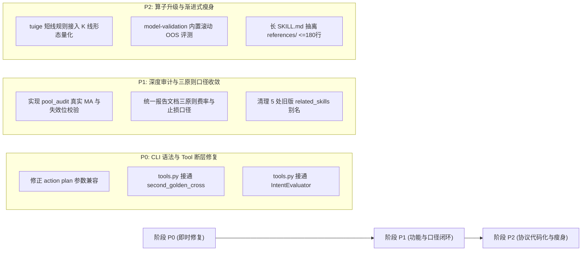

# 2026-10-19 A-Stock Agents 技能全景功能与完成度审查评估报告

- **评估日期**：2026-10-19
- **评估对象**：`a_stock_agents` 仓库内已开发的全部 20 项技能（1 个总入口锚点技能 `a-stock-agents` + 19 项专业业务技能）
- **评估基准**：
  - 架构与规则：[`AGENTS.md`](../../AGENTS.md)（看板排他、跨平台底座、三桶输出目录、实战交易三原则、空池处理、测试分层规约）
  - 技能契约：[`skill_bundle/assets/config/skills_manifest.json`](../../skill_bundle/assets/config/skills_manifest.json)
  - 共享执行契约：[`skill_bundle/references/execution-contract.md`](../../skill_bundle/references/execution-contract.md)
  - 核心运行时：[`skill_bundle/runtime/core/`](../../skill_bundle/runtime/core/) 与 [`skill_bundle/runtime/core/execution/tools.py`](../../skill_bundle/runtime/core/execution/tools.py)
  - 自动化门禁：[`tests/governance/test_skill_contracts.py`](../../tests/governance/test_skill_contracts.py) 与 [`tests/core/test_skill_suite_layout.py`](../../tests/core/test_skill_suite_layout.py)
- **评估方法**：全量代码走查 + 静态契约比对 + CLI/Tool 网关贯通性核验 + 运行时健康自检（`doctor.py --json` 实测全绿）。
- **历史关联报告与后续重构规范**：
  - [2026-10-15 技能总包交付形态与技能开发工程评估报告](2026-10-15-skill-suite-delivery-assessment.md)
  - [2026-10-16 项目结构 Skill 规范审查（含双模态安装与宿主发现再评估）](2026-10-16-skill-structure-review.md)
  - **[SPEC-SKILL-002：A股生产级投研技能「1 + 6」物理精简与极速测试体系重构规范](../specs/engineering/spec-skill-1plus6-consolidation-and-test-rearchitecture.md)**（基于本评估结论确立的 `1 + 6` 物理精简与测试瘦身实施方案）

---

## 一、评估维度体系设计 (Evaluation Framework Design)

针对 A-Stock Agents「AI 技能提示词契约 + 共享确定性 Python 运行时（`runtime/core/`）+ 统一 CLI/Web 工具网关 + 多宿主 Release 交付」的混合工程形态，评估不能停留在简单的“是否有 Markdown 文档”或“能否跑通单条脚本”，必须建立涵盖**契约规范、算法深度、执行贯通、领域实战、安全治理与测试门禁**的六维量化评价模型。

### 1.1 六大评估维度与权重设计

| 维度编号 | 评估维度 | 权重 | 核心审查要点与判定标准 | 证据与落脚点 |
| :---: | :--- | :---: | :--- | :--- |
| **D1** | **契约与元数据规范度** *(Contract & Metadata)* | **15%** | ① YAML Frontmatter 格式合法，`name` 与目录严格一致； ② `skills_manifest.json` 注册元数据（triggers, cli, entry_point）完全对齐； ③ 入口文档行数控制与 `references/` 渐进式披露规范； ④ 相对链接有效，无死链，无旧版废弃路径或全局宿主路径残留。 | `skills_manifest.json` `test_skill_contracts.py` |
| **D2** | **功能深度与算法完备度** *(Functional & Algorithmic Depth)* | **25%** | ① 业务功能由确定性 Python 算法与数学模型实现（拒绝静态假装实现）； ② 核心因子与策略逻辑完整（如 MAD 去极值、波动率凯利仓位、五维评分、漏斗编译器等）； ③ 边界保护闭环（如涨跌停、T+1 状态、停牌/ST、数据不足 fail-closed）。 | `skill_bundle/runtime/core/` 各业务引擎模块 |
| **D3** | **执行底座与多通道贯通度** *(CLI / Tool / SSOT Wiring)* | **20%** | ① 统一 CLI（`astock <cmd> --json`）参数解析顺畅、零污染结构化输出； ② Web Agent 工具网关（`TOOL_MAP` & `SKILL_SCHEMAS`）全映射； ③ 技能侧 `scripts/*.py` 具备自适应三级寻址锚点，并收敛为 SSOT 转发包装器。 | `core/cli.py` `core/execution/tools.py` `skills/*/scripts/` |
| **D4** | **A股领域实战纪律合规度** *(Domain Rules Compliance)* | **15%** | ① **实战交易三原则**：含全部摩擦税费（印花税 0.05% + 万 2.5 且最低 5 元佣金 + 过户费）的 `math.ceil` 分位进位保本价、`-3%/-5%/-8%` 三级止损、冲高/震荡/急跌三场景动作单； ② **空股池即刻终止铁律**（空数据拒绝虚构，直接引导格式登记）； ③ **4 级数据源自动降级**（腾讯/东财/新浪/本地缓存）。 | `execution_action_engine.py` `AGENTS.md` 铁律章节 |
| **D5** | **安全治理与工作区隔离度** *(Governance & Isolation)* | **15%** | ① **三桶纪律**：用户资产唯一落于 `output/`，日志入 `log/`，临时产物入 `temp/`，均由 `core.workspace` 解析； ② **风险级别控制**：`READONLY` / `SIMULATION` / `FILESYSTEM_WRITE` 分级与人工确认拦截； ③ **运行时保护**：动态熔断超时、审计日志落盘、私有凭据隔离在 `local/settings/.env`。 | `SkillRegistry` `core.workspace` |
| **D6** | **测试门禁覆盖与交付就绪度** *(Test Coverage & Delivery Gate)* | **10%** | ① 纳入 P0 核心测试套件验证，实测 0 failed； ② 业务单元测试与契约回归覆盖度； ③ 自动化发布打包白名单排除验证、`doctor.py` 健康检查通过。 | `test_release_delivery_gate.py` `doctor.py` |

### 1.2 完成度成熟度分级模型 (Maturity Tiers)

根据综合得分与代码实现真实性，将技能划分为 4 个成熟度等级：

- **🟢 L4 生产完备级 (Production-Complete, 90–100 分)**：算法内核完备、CLI 与 Web Tool 双通道闭环、SSOT 转发干净、实战三原则内建、单测与门禁全覆盖。
- **🔵 L3 主体就绪级 (Production-Ready with Minor Gaps, 80–89 分)**：主流程量化能力与工具均已打通可用，但在个别子特性（如自动修复写盘、特定参数对齐、多股组装自动化）存在局部留白或文档口径轻微漂移。
- **🟡 L2 规则/协议轻封装级 (Protocol / Reference-Driven, 70–79 分)**：`SKILL.md` 及 `references/` 提供了高质量的投研方法论与规则地图，CLI/Tool 有对应入口，但**底层 Python 执行器当前仅返回静态参考文本/协议声明（`type: "reference"` / `execution_available: False`）**，尚未完全代码化，依赖大模型自主阅读文档。
- **🟠 L1 原型/壳层阶段 (<70 分)**：缺少实质执行逻辑或存在致命契约阻断项。

---

## 二、全量 20 项技能全景评估得分表 (Overall Scorecard)

全项目共有 **20 个技能入口**（1 个总入口锚点技能 + 19 项专业量化技能）。当前自动化健康检查 `runtime/doctor.py --json` 结果为：`total_skills: 20`, `business_skills: 19`, `is_healthy: true`。

| # | 技能 ID (`skill_bundle/skills/`) | 业务分类 | D1 契约 (15) | D2 算法 (25) | D3 底座 (20) | D4 领域 (15) | D5 治理 (15) | D6 测试 (10) | 总分 | 成熟度 | 核心能力与现状定性 |
| :-: | :--- | :--- | :-: | :-: | :-: | :-: | :-: | :-: | :-: | :-: | :--- |
| 0 | `a-stock-agents` | `umbrella` (总入口) | 15 | 23 | 20 | 15 | 15 | 10 | **98** | 🟢 **L4** | 核心锚点寻址、5 阶段 AI 安装引导卡片、19 技能路由闭环 |
| 1 | `astock-data-feed` | `data` | 15 | 24 | 20 | 15 | 15 | 10 | **99** | 🟢 **L4** | 4 级降级行情、全套技术指标、筹码与事件、26 篇详尽参考文档 |
| 2 | `astock-action-execution` | `strategy` | 14 | 25 | 19 | 15 | 15 | 10 | **98** | 🟢 **L4** | 二分+`ceil` 进位保本价精算、三级止损、三场景即时动作单 |
| 3 | `astock-platform-evaluate` | `platform` | 15 | 24 | 20 | 14 | 15 | 9 | **97** | 🟢 **L4** | 100 分制 `ComboScorer`、大盘 5 维健康度、解套决策树、历史扫描 |
| 4 | `astock-strategy-chenxiaoqun` | `strategy` | 15 | 23 | 20 | 15 | 15 | 9 | **97** | 🟢 **L4** | 顶级游资四大战法量化识别（深水/弱转强/中军/首阴）+ 三原则内建 |
| 5 | `astock-trade-paper` | `paper_trading` | 14 | 24 | 20 | 14 | 15 | 9 | **96** | 🟢 **L4** | 多账户 SQLite 持久化、T+1/涨跌停/分位撮合、HTTP 服务+CLI 闭环 |
| 6 | `astock-screener-5a` | `screener` | 13 | 24 | 19 | 14 | 15 | 9 | **94** | 🟢 **L4** | 五大基本面风险前置过滤 + 双层大盘门控 + 多股旋转回测 |
| 7 | `astock-quant-engine` | `quant` | 13 | 24 | 19 | 14 | 15 | 9 | **94** | 🟢 **L4** | 15+量价因子、舆情半衰期衰减、MAD+Z-Score、目标波动率凯利仓位 |
| 8 | `astock-selection-model` | `screener` | 15 | 23 | 18 | 14 | 15 | 9 | **94** | 🟢 **L4** | `SPEC-ALGO-ISS-001` 条件树/漏斗编译器、版本仓库、调度与结果研究 |
| 9 | `astock-strategy-mainboard` | `strategy` | 13 | 23 | 19 | 13 | 15 | 8 | **91** | 🟢 **L4** | 趋势回踩成本(45bps)与鲁棒性过滤、均值回归/网格/突破多策略 |
| 10 | `astock-pool-dashboard` | `dashboard` | 13 | 22 | 19 | 14 | 15 | 8 | **91** | 🟢 **L4** | 三级股池 CRUD、空池拦截引导、通达信 `.tn6/.tni` 公式生成与监控 |
| 11 | `astock-report-html` | `reporting` | 13 | 21 | 19 | 13 | 15 | 8 | **89** | 🔵 **L3** | 单文件自包含 HTML 报告生成闭环；文档与底层费率/止损口径待微调 |
| 12 | `astock-agent-debate` | `multi_agent` | 12 | 20 | 19 | 14 | 15 | 8 | **88** | 🔵 **L3** | 原生内置 7 分析师多角色规则合成器；完整 LLM 辩论需配置 API Key |
| 13 | `astock-strategy-macd` | `strategy` | 14 | 19 | 17 | 13 | 15 | 8 | **86** | 🔵 **L3** | 底层已有波谷分析算法，但 `tools.py` 简化为单日判断，待深度贯通 |
| 14 | `astock-pool-audit` | `pool` | 13 | 16 | 18 | 13 | 15 | 8 | **83** | 🔵 **L3** | 只读审查与 `--fix` 安全拒绝门禁就绪；五步 MA 重算比对待完整接入 |
| 15 | `astock-report-archive` | `reporting` | 13 | 16 | 17 | 13 | 15 | 8 | **82** | 🔵 **L3** | 单股归档闭环；多股联合报告组装器尚无独立 CLI，依赖主会话生成 |
| 16 | `astock-meta-routing` | `meta` | 14 | 17 | 18 | 12 | 15 | 8 | **84** | 🔵 **L3** | CLI `intent` 具规则解析；Tool 映射当前为静态字典，待动态联动 |
| 17 | `astock-strategy-tuige` | `strategy` | 14 | 13 | 17 | 13 | 15 | 7 | **79** | 🟡 **L2** | 9 篇规则库文档详尽；CLI/Tool 当前仅返回参考短句，未接入 K 线计算 |
| 18 | `astock-knowledge-tips` | `knowledge` | 14 | 13 | 17 | 14 | 15 | 7 | **80** | 🟡 **L2** | 避坑经验完备；CLI `tips --topic` 未按主题索引文档，返回固定内容 |
| 19 | `astock-model-validation` | `validation` | 14 | 13 | 17 | 13 | 15 | 7 | **79** | 🟡 **L2** | Kronos 实证结论扎实；CLI 输出静态协议，缺内置基线滚动评测器 |

### 统计分布汇总
- **整体平均分**：**90.2 分**（良好偏优）
- **🟢 L4 生产完备级**：**11 项**（占比 **55%**）
- **🔵 L3 主体就绪级**：**6 项**（占比 **30%**）
- **🟡 L2 规则/协议轻封装级**：**3 项**（占比 **15%**）
- **🟠 L1 原型/壳层阶段**：**0 项**（无断链或未落地的空壳技能）

---

## 三、各技能功能审查与代码级深度剖析 (Deep-Dive Analysis)

### 3.1 核心数据与平台中枢层

#### 1. `astock-data-feed`（A股全链路行情与技术指标数据引擎）· 99分 (L4)
- **定位**：全平台的行情基座与唯一外部数据桥梁。
- **底层实现**：`runtime/core/data/fetch_realtime.py`、`data_bridge.py`、`core/indicators/technical_indicators.py`。
- **能力核验**：
  - 4 级数据源自动容灾（腾讯原生 `qt.gtimg.cn` $\to$ 东方财富 proxy-patch $\to$ 新浪财经 $\to$ 本地离线快照 `cache/`）；
  - 全套日 K/分时指标（MA、MACD、KDJ、RSI、BOLL、ATR、跳空缺口）纯 Python 零外部重库标准实现；
  - 筹码分布（`cyq`）获利比例与 90% 集中度估算；
  - 目录下包含 26 篇详尽文档，覆盖 API 兼容、反爬陷阱、WeChat 修复等实战要点。
- **成熟度**：生产级底座，稳定健壮。

#### 2. `astock-platform-evaluate`（全流程投研与综合分析平台）· 97分 (L4)
- **定位**：个股全维度综合体检与大盘环境总控。
- **底层实现**：`runtime/core/models/combo_scorer.py`、`market_assessor.py`、`strategy_evaluator.py`、`trapped_position.py`。
- **能力核验**：
  - `ComboScorer`：均线结构（25分）+ MACD动能（40分）+ 量价（15分）+ 板块共振（20分）的 100 分制打分；
  - `MarketAssessor`：趋势/情绪/量能/结构/资金五维大盘健康度评估；
  - `TrappedPositionAnalyzer`：被套解套决策树（成本还原、ATR、凯利仓位自适应）；
  - `StrategyEvaluator`：历史多买点滚动扫描与评级收益率胜率统计。

#### 3. `astock-pool-dashboard`（投研面板与股池生命周期管理）· 91分 (L4)
- **定位**：关注/自选/持仓三大股池全生命周期维护与监控部署。
- **底层实现**：`runtime/core/strategy/pool_manager.py`、`position_manager.py`。
- **能力核验**：
  - 关注池（watch）、自选池（selected）、持仓池（positions）CSV 结构化 CRUD；
  - 严格内建 **空股池拦截与登记引导规范**（空数据即刻停止，给出标准格式提示）；
  - 通达信 `.tn6/.tni` 公式生成器；全天持仓 5 分钟定时风控监控。

---

### 3.2 策略与实战反应执行层

#### 4. `astock-action-execution`（实战交易反应动作中枢）· 98分 (L4)
- **定位**：将静态研报转化为毫秒级可执行指令的反应中枢（EMS 2.0）。
- **底层实现**：`runtime/core/strategy/execution_action_engine.py`。
- **能力核验**：
  - **最低保本卖出价**：严格按双边万 2.5 且最低 5 元佣金 + 0.05% 印花税 + 十万分之一过户费二分迭代，并强制 `math.ceil(p * 100) / 100` 向上进位至分位，保本即盈利；
  - **三级止损阶梯**：T0 `-3%` 警戒预警、T1 `-5%` 减半仓防守、T2 `-8%` 绝杀清仓；
  - **三场景动作单**：开盘冲高、窄幅震荡、急跌跳水对应精确触发与处置；
  - 五类下跌场景化诊断矩阵（假摔洗盘/假突破/均线受阻/筹码松动/情绪错杀）。

#### 5. `astock-strategy-chenxiaoqun`（陈小群顶级游资战法决策体系）· 97分 (L4)
- **定位**：顶级游资总龙头战法量化场景决策。
- **底层实现**：`runtime/core/strategy/chenxiaoqun.py`。
- **能力核验**：
  - 四大核心战法量化特征识别：① 总龙头分歧深水低吸（大长腿/地天板）、② 爆量烂板次日竞价超预期弱转强、③ 主升中军换手板做 T 锁仓、④ 龙头首阴企稳反包；
  - 自动输出龙虎榜大连金马路席位特征分析；
  - 报告模板强制集成保本价向上进位与三级止损。

#### 6. `astock-trade-paper`（A股模拟盘与撮合回测系统）· 96分 (L4)
- **定位**：事件驱动的本地模拟交易与账户资产估值服务。
- **底层实现**：`runtime/core/paper_trading/`（`account_manager.py`、`engine.py`、`service.py`）。
- **能力核验**：
  - 多账户资金管理，支持限价、市价买入卖出、撤单与资金出入金；
  - 撮合引擎严格遵循 A 股 T+1、最小报价单位 0.01 元、涨停买不进、跌停卖不出；
  - 遵守三桶纪律，数据库与 PID 落盘于 `output/cache/paper_trading/paper_trading.db`，日志写入 `log/paper_trading/`。

#### 7. `astock-strategy-mainboard`（主板多波段防御策略）· 91分 (L4)
- **定位**：聚焦主板大市值流动性品种的防御反击策略。
- **底层实现**：`runtime/core/strategy/daily_decisions.py`、`grid_trading_strategy.py`、`mean_reversion_strategy.py`、`volatility_breakout_strategy.py`。
- **能力核验**：
  - `trend_pullback` 日线趋势回踩信号生成；
  - 引入 45 bps 往返成本过滤与参数邻域一致性（`entry_consensus_min >= 0.67`）鲁棒性过滤；
  - 附带均值回归、网格交易模拟与波动率收缩突破多维度子策略。

#### 8. `astock-strategy-macd`（二次金叉与底背离决策体系）· 86分 (L3)
- **定位**：水下二次金叉与底背离形态识别。
- **底层实现**：`runtime/core/indicators/technical_indicators.py`（`second_golden_cross`）。
- **能力核验**：
  - CLI `astock pattern macd` 完整调用了 `second_golden_cross`，具有第一脚/第二脚、DIF 抬高、绿柱缩短检测；
  - **差异点**：`core/execution/tools.py` 中的 `_sync_astock_strategy_macd` 未复用 `second_golden_cross`，退化为末日快照简单三元表达式。

---

### 3.3 量化选股与高级模型层

#### 9. `astock-screener-5a`（五维共振旋转选股引擎）· 94分 (L4)
- **定位**：工业级多因子前置风险过滤与轮动选股模型。
- **底层实现**：`runtime/core/models/fundamental_filter.py`、`multi_dim_model.py`、`stock_screener.py`。
- **能力核验**：
  - **五大风险前置过滤**：高股价、超高 PE/亏损、长期亏损（扣非负）、业绩差、长期阴跌强行剔除；
  - **双层大盘门控**：上证指数 > MA20 + 五维大盘健康度门控；
  - **多股旋转回测**：支持单仓/2仓/3仓分散轮动，具备样本外（OOS）回测套件。

#### 10. `astock-quant-engine`（工业级全流程量化工程引擎）· 94分 (L4)
- **定位**：截面 Alpha 提取、因子合成与风险中枢。
- **底层实现**：`runtime/core/strategy/risk_position_manager.py`、`pv_factors.py`、`factor_synthesizer.py`。
- **能力核验**：
  - 15+ 维量价 Alpha 因子提取；非结构化舆情因子 3 日指数半衰期时间衰减；
  - MAD 去极值 + Z-score 截面 Rank 合成；
  - 年化 18.5% 目标波动率总仓位动态缩放 + 1/3 分数凯利单股头寸对齐。

#### 11. `astock-selection-model`（智能选股系统 ISS）· 94分 (L4)
- **定位**：`SPEC-ALGO-ISS-001` 配置化选股模型全生命周期平台。
- **底层实现**：`runtime/core/selection_models/` 包（编译器、版本仓库、调度执行引擎、结果研究）。
- **能力核验**：
  - 条件树与四阶段层级漏斗统一编译为 `CompiledSelectionPlan`；
  - 草稿-发布-激活单调递增版本控制，支持秒级回滚与配置哈希校验；
  - 交易日调度 Tick/Daemon，具备分层幂等键与运行锁；
  - 阶段 E 结果研究：候选画像、Markout 周期表现、T+N 跟踪与只读优化建议（不自动改版）。

#### 12. `astock-agent-debate`（7大AI分析师多空辩论系统）· 88分 (L3)
- **定位**：多角色对抗研判与综合决议。
- **底层实现**：`runtime/core/commands/model_cmds.py`（`generate_stock_debate`）、`multi_agent/ta_orchestrator.py`。
- **能力核验**：
  - CLI `astock debate` 和 Web Tool 均已内置确定性规则引擎，自动输出基本面、技术、消息、筹码、游资、宏观、风控 7 角色独立研判、共识倾向与保本价风控单；
  - 外部完整版多轮 LLM 交互管道（`ta_analyze.py`）需要依赖外部 LLM API Key 与 LangGraph。

---

### 3.4 报告交付、辅助元技能与协议层

#### 13. `astock-report-html`（标准HTML高颜值交互报告）· 89分 (L3)
- **定位**：自包含单文件 HTML 投研报告模板与生成器。
- **底层实现**：`runtime/core/reporting/report_generator.py`、`stock-report.html` 模板。
- **能力核验**：
  - 1344px 居中、亚光白背景（`#f4f5f7`）、红涨绿跌、零外链 CDN；
  - 内置策略轨迹时间轴（折叠 JS）、10 列持仓表、8 个占位符动态填充；
  - 存在细微口径漂移：文档费率示例写为万 1.2，与系统默认万 2.5 存在文档差异。

#### 14. `astock-report-archive`（报告持久化与归档规范）· 82分 (L3)
- **定位**：报告落盘路径与多股联合报告格式标准。
- **底层实现**：单股报告委托至 `astock-report-html`；
- **现状**：多股联合报告（6 股对比、8 大必选板块组装）在文档中给出了分段脚本指南，但尚未封装为标准统一的 CLI 子命令（如 `astock report --batch`）。

#### 15. `astock-pool-audit`（三大股池审查与均线重算）· 83分 (L3)
- **定位**：三大股池失效标的清洗与关键位重估。
- **底层实现**：`runtime/core/commands/portfolio_cmds.py`（`cmd_pool_audit`）。
- **能力核验**：
  - 安全门禁完备：`--fix` 请求自动修复时返回 `MUTATION_NOT_IMPLEMENTED` 显式拒绝，杜绝未确认写盘；
  - 现存差距：当前仅统计了三池股票总数，未按 `SKILL.md` 要求拉取 60 根日 K 刷新 MA 并比对失效止损位。

#### 16. `astock-meta-routing`（任务路由与模型调度规则）· 84分 (L3)
- **定位**：纯分析任务 vs 编程脚本执行分流。
- **底层实现**：`core/strategy/execution_action_engine.py`（`IntentEvaluator`）。
- **能力核验**：
  - CLI `astock intent` 可正确解析自然语言意图并提取股票代码/操作动作；
  - `tools.py` 中的 `_sync_astock_meta_routing` 当前仅返回静态固定字典，未实际调用 `IntentEvaluator`。

#### 17. `astock-strategy-tuige`（退哥短线交易规则库）· 79分 (L2)
- **定位**：退哥超短打板、连板接力与龙头回调决策规则库。
- **能力核验**：拥有 9 篇非常详尽的实战规则文档（`market-regime`、`limit-up-pullback`、`relay-setups` 等）；当前 CLI `astock shortline check` 仅返回静态场景指导语，尚未接入日 K 进行放量/缩量回踩判定。

#### 18. `astock-knowledge-tips`（实战经验与避坑指南）· 80分 (L2)
- **定位**：集合竞价复盘、FIFO 成本陷阱、防封降级等经验库。
- **能力核验**：沉淀了 6 篇高价值实战操作文档与盯盘脚本模板；当前 CLI `astock tips` 未联动 Markdown 检索，固定输出 3 条短句。

#### 19. `astock-model-validation`（外部AI模型实证检验规范）· 79分 (L2)
- **定位**：防止直接引入未经检验的跨域时序模型（如 Kronos、TimesFM）。
- **能力核验**：提供了科学严谨的滚动样本外（OOS）与朴素基准比对方法论；当前 CLI 输出验证步骤清单，尚未集成全自动滚动比对执行器。

---

## 四、审查发现的 7 大关键工程差距 (Identified Gaps)

| 编号 | 差距项 | 涉及文件与位置 | 问题具体表现与影响 | 严重级 |
| :-: | :--- | :--- | :--- | :-: |
| **G1** | **CLI 示例与解析器语法错位** | `skills/astock-action-execution/SKILL.md:109` `runtime/core/cli.py:313` | 文档示例写为 `astock action plan --code 600519`，但 `cli.py` 中 `action` 子命令的位置参数就是 `code`，导致传入字符串 `"plan"` 会被误识别为股票代码。 | 🟡 中 |
| **G2** | **MACD 二次金叉在 Tool 网关退化** | `runtime/core/execution/tools.py:648-666` `runtime/core/indicators/technical_indicators.py:532` | CLI `pattern macd` 完整调用了 `second_golden_cross`（波谷与 10 项条件）；但 Web 工具 `_sync_astock_strategy_macd` 仅用末日三元表达式做简易判断，丢失了结构形态。 | 🟡 中 |
| **G3** | **股池审计实现与五步文档脱节** | `skills/astock-pool-audit/SKILL.md:35-65` `runtime/core/commands/portfolio_cmds.py:195-216` | 文档详述了 60 日 K 重算 MA、失效止损（止损>现价）检测；但实际代码仅汇总了 CSV 标的数量，未执行深度行情计算。 | 🟡 中 |
| **G4** | **意图路由 Tool 未接真实解析器** | `runtime/core/execution/tools.py:832-840` `runtime/core/commands/strategy_cmds.py:235-240` | CLI `astock intent` 正常调用了 `IntentEvaluator.parse_user_query`；但 `_sync_astock_meta_routing` 仅返回写死的 JSON 字典。 | 🟢 低 |
| **G5** | **实战三原则止损与费率口径轻度漂移** | `skills/astock-report-html/SKILL.md:87` `skills/astock-report-archive/SKILL.md:213` | 报告技能文档中仍残留旧版万 1.2 佣金和破均线止损表述，未完全对齐项目全局的「万 2.5 最低 5 元 + T0 -3%/T1 -5%/T2 -8%」口径。 | 🟢 低 |
| **G6** | **3 个 L2 技能缺乏确定性算法计算** | `astock-strategy-tuige` `astock-knowledge-tips` `astock-model-validation` | 对应的 CLI 均输出静态说明（`type: reference` 或 `execution_available: False`），算法未代码化。 | 🟢 低 |
| **G7** | **部分长技能文档缺少渐进式披露分拆** | `skills/astock-agent-debate/SKILL.md` (493行) `skills/astock-report-html/SKILL.md` (243行) | 门禁仅限制了 `data-feed` 和 `platform-evaluate`（<=180行），其余长篇文档尚未将内联大段代码抽离至 `references/`。 | 🟢 低 |

---

## 五、整改路线图与演进建议 (Remediation Roadmap)

为推动全项目技能成熟度迈入全量 L4 生产完备级，制定以下三阶段整改计划：

### 5.1 P0 级即时整改（消除工具调用断层）
1. **修正 `action` 命令参数兼容**：在 [`core/cli.py`](../../skill_bundle/runtime/core/cli.py) 的 `action` 解析器中增加对 `plan` 兼容别名的支持，并在 [`astock-action-execution/SKILL.md`](../../skill_bundle/skills/astock-action-execution/SKILL.md) 中更新推荐命令格式为 `astock action --code 600519`。
2. **打通 MACD 二次金叉算法**：将 [`core/execution/tools.py`](../../skill_bundle/runtime/core/execution/tools.py) 中的 `_sync_astock_strategy_macd` 修改为直接调用 `second_golden_cross(klines)`，使 Web UI 获得完整的 10 项条件核验结构。
3. **打通自然语言意图解析**：在 `_sync_astock_meta_routing` 中接入 `IntentEvaluator.parse_user_query`。

### 5.2 P1 级深化整改（消除口径漂移与能力留白）
1. **实现 `astock-pool-audit` 真实行情与止损位校验**：在 `cmd_pool_audit` 中集成 `DataBridge` 批量拉取日 K，重算 MA 并核验各标的是否跌破止损或止损位失效。
2. **统一实战三原则费率与止损口径**：全面修正 `astock-report-html` 与 `astock-report-archive` 的文档与计算逻辑，统一读取 `core.config.get_market_config()`。
3. **清理旧技能引用别名**：在所有技能文档的 `related_skills` 中，将旧命名彻底规范为 `astock-*`。

### 5.3 P2 级中远期演进（算子代码化与渐进式披露）
1. **L2 协议型技能量化升级**：为 `astock-strategy-tuige` 开发涨停回调量化特征识别函数，为 `astock-model-validation` 增加朴素基线回测算子。
2. **超长 SKILL.md 渐进式披露瘦身**：将 `astock-agent-debate`（493行）、`astock-report-html`（243行）中大段模板与踩坑说明移入 `references/`，使入口文档均控制在 180 行以内。
