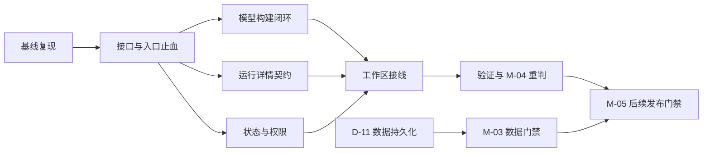

# 智能选股工作区修复计划（2026-10-08）

> 关联规范编号：`SPEC-ALGO-ISS-001` / `SPEC-ALGO-ISS-MT-001`
> 权威定义 (SSOT)：[`selection-system-specification.md`](../../guidelines/algorithm/selection-system-specification.md)、[`selection-model-types-specification.md`](../../guidelines/algorithm/selection-model-types-specification.md)
> **实施状态**：✅ R0～R6 已完成（2026-10-09）；M-04 功能闭环已复测，正式里程碑仍受 M-03/D-11 依赖约束，分阶段证据与门禁结果见下文

## 结论与范围

以本计划关联的两份 SSOT 和[《智能选股系统功能建设实施看板》](selection-system-plan.md)为验收依据。R0 基线发现“空白建模→编辑→保存→校验→发布→激活→运行→查看每层结果”的 Web 闭环当时未可靠成立，因此撤回旧 M-04“已达成”判定。R1～R6 已修复并复测 API/Web 功能闭环；正式 M-04 仍须满足 M-03 前置依赖及全项门禁，D-11 数据持久化和 M-05 正式信号发布独立验收。

参考设计：[工作区截图](../../images/23_16_36.png)与[选股模型工作台备份页](../../../apps/web-console/frontend/backup/选股模型工作台.html)。该 HTML 是静态演示，含固定模型名、5 层数量、股票行情、假分页及只弹窗的停止按钮，不能作为业务数据或直接复制进生产页面。

## 参考图评估与目标信息架构

| 参考图元素 | 可保留的设计 | 生产实现要求 |
|---|---|---|
| 左侧模型实例列表 | 清楚的选中态、模型名与状态摘要 | 接 `GET /api/selection-models`；状态拆为草稿、活动版本、运行实例与调度器状态，不能以“已激活”推断“运行中” |
| 顶部模型标题与操作 | 清晰的当前模型上下文和主要操作 | 显示模型 ID/类型/活动版本/当前 run_id；按状态和权限启用操作；停止只针对可取消的运行实例 |
| 中间纵向漏斗 | 强调层级顺序、当前层及通过量 | 从指定 run_id 的阶段记录生成；每层显示 input/output/reject/unknown、状态、时间、水位；未运行显示空态，不显示预设 5 层与数量 |
| 右侧当前层股票表 | 点击层级后查看该层候选，符合任务流 | 用 run_id + stage_id 查询通过/淘汰候选；搜索、分页、总数均由真实数据契约支持；行情字段带 `as_of`/来源，缺失显示“未提供” |
| 运行日志与导出 | 上下文内可发现 | 日志链接到运行事件/审计；导出与当前 run_id、stage_id、过滤条件一致，并标注数据时点 |

参考图只适合**运行详情/结果页**。模型构建器应是独立视图：左侧规则库，中间条件树或阶段编排画布，右侧属性抽屉。模型中心、编辑、运行详情、研究/跟踪/评价需要明确导航层次，避免把“漏斗运行图”当成编辑画布。

设计落地时沿用现有应用视觉变量，不照搬备份页的 2040px 固定画布和 `transform: scale(...)`。桌面保留三栏关系；窄屏按“模型列表→漏斗→当前层候选”顺序纵向排列。状态必须有文字、图标与颜色共同表达；按钮提供禁用原因、加载反馈、键盘焦点和可访问名称。

## 实施进度总览

状态口径：`⬜ 未开始`、`🟡 进行中`、`⛔ 阻塞`、`✅ 已完成`。只有该阶段所有复选项完成、验收证据已登记且不存在阻断缺陷时，才可标记 `✅`。日期填写实际完成日；不预填预计日期。代码路径与证据路径随实施记录，不能用“代码已提交”替代运行结果。

| 阶段 | 依赖 | 当前状态 | 完成日期 | 验收证据 / 阻塞说明 |
|:---:|---|:---:|:---:|---|
| R0 可复现基线 | 无 | ✅ 已完成 | 2026-10-08 | [R0 基线记录](selection-workbench-r0-baseline.md)：R0-1～R0-3、V-01～V-05 均已取证；当前 P0 通过 |
| R1 接口与旧入口止血 | R0 | ✅ 已完成 | 2026-10-09 | 下方 R1-1～R1-3 代码与隔离测试证据；P0 227 passed，定向 P1 25 passed，浏览器 E2E 2 passed |
| R2 草稿及模型构建闭环 | R1 | ✅ 已完成 | 2026-10-09 | 下方 R2-1～R2-4 代码与隔离测试证据；P0 228 passed，定向 P1 19 passed，浏览器 E2E 1 passed |
| R3 运行详情数据契约 | R1 | ✅ 已完成 | 2026-10-09 | API/浏览器复测通过；同模型双运行、阶段计数、筛选分页、CSV 与缺失水位均有隔离证据；见 R6 台账 |
| R4 权限、调度与停止语义 | R1；权限裁定复核 | ✅ 已完成 | 2026-10-09 | 下方 R4-1～R4-4；P0 230 passed，定向 P1 23 passed，隔离浏览器 E2E 1 passed |
| R5 参考图工作区接线 | R2、R3、R4 | ✅ 已完成 | 2026-10-09 | R5-1～R5-4 经 Edge 全组与桌面/窄屏场景复测；静态零值占位已纠正；见 R6 台账 |
| R6 验证、里程碑与文档收口 | R1～R5 | ✅ 已完成 | 2026-10-09 | P0 230 passed；P0+P1 528 passed；隔离 Edge 13 passed；双运行本地快照与 M-04 修订见下文 |

## 实施任务清单

### R0 · 可复现基线

- [x] **R0-1** 确认当前服务进程对应的工作区与代码版本；记录健康检查、选股接口认证状态、页面脚本版本。**状态：✅ 已完成（2026-10-08）**；当前 HEAD 的隔离进程可对应，旧 6300 进程的精确加载提交仍明确为未知。证据：[R0 基线记录](selection-workbench-r0-baseline.md)。
- [x] **R0-2** 使用隔离模型与测试身份，记录未登录、仅查看、模型作者和管理员的页面加载与关键动作；不读取或修改用户现有模型。**状态：✅ 已完成（2026-10-08）**；浏览器同源取证使用临时 API 地址适配，正式产品仍需修复非 6300 页面的 API 接线。证据：[R0 基线记录](selection-workbench-r0-baseline.md)。
- [x] **R0-3** 将失败现象映射到 API 响应、浏览器错误和代码入口；建立后续逐项复测清单。**状态：✅ 已完成（2026-10-08）**。证据：[R0 基线记录](selection-workbench-r0-baseline.md)。

### R0 补充验证清单（评估于 2026-10-08）

以下项目把尚未验证的事实转成可判定的证据；勾选前记录请求时间、隔离服务进程、模型 ID 和实际响应。R0-3 已完成，不因后续发现的新缺陷回退。旧 6300 进程的精确加载提交不可追溯时，应如实保留“未知”；以明确记录当前 HEAD 的新隔离进程作为后续复测基线。

| 编号 | 归属 | 需要补充的核验 | 通过标准与证据 | 状态 |
|---|---|---|---|:---:|
| V-01 | R0-1 | 为后续复测启动当前工作区的隔离服务，记录启动前 HEAD、工作树状态、进程 PID/命令/启动时间、隔离数据库与仓库路径、健康响应和页面脚本版本；保留旧 6300 进程的已知信息 | 新服务的代码来源、进程和响应可一一对应；旧服务的未知提交明确标注，不把静态资源版本当作 Python 版本 | ✅ 已取证 |
| V-02 | R0-2 前置 | 修通隔离浏览器的 API 地址；用浏览器网络记录确认页面、选股 API 与登录 API 均指向同一隔离服务，不转向 6300 | 请求目标、HTTP 状态及隔离服务访问记录一致；首屏不再出现由测试地址接线导致的 Failed to fetch | ✅ 已取证；`web/js/api.js` 已改为仅 3000/5173 开发端口回指 6300，其他端口保持同源 |
| V-03 | R0-2 | 在独立会话中依次检查未登录、只读 researcher、模型作者、管理员；每次用 /api/auth/me 核对身份，打开选股页并操作隔离模型的查看、创建、保存、发布、激活、运行、调试入口 | 四角色的页面加载、按钮状态、提示和对应 API 响应均记录；拒绝动作不能改动隔离模型；用户现有模型未被读取或修改 | ✅ 已取证，暴露权限提示问题 |
| V-04 | R0-2/R0-3 | 对 401、403、业务 error 和浏览器请求失败分别保存网络状态/响应、页面文案与控制台错误；对模型切换和首次加载记录触发顺序 | 每个现象能关联到具体请求、前端入口和隔离模型；浏览器网络故障与后端业务拒绝分开归因 | ✅ 定向隔离 Edge E2E 通过；403 的 `[object Object]` 文案缺陷已稳定复现并转入 R1-3，不阻断基线取证 |
| V-05 | 代码改动门禁 | 恢复 P0 运行环境后验证 Windows 档位映射和核心门禁；先核对 core 选中数大于 0，再执行规定的 P0 命令 | 记录实际选中/通过/失败数与运行时长；无 0x8007000e、无失败，才能将 P0 标为通过。当前测试指南的 132/430 数量是旧基线，需与实际收集数核对 | ✅ 565 collected；227 passed、338 deselected、0 failed，70.91s |

V-01～V-04 用于关闭 R0-1/R0-2；V-05 是代码改动的测试门禁，不替代四角色浏览器取证。真实 run_id 的节点/候选归属、两次运行隔离与导出对账分别由 R1/R3 验收；权限裁定及停止语义由 R4 验收。P1、全量、network 和 live 测试仍按工作区规约先取得人工确认。

### R1 · 接口与旧入口止血

- [x] **R1-1** 修正 `scripts/server/api/selection_models.py` 中 `/{model_id}/runs` 与 `/runs/{run_id}` 的匹配顺序或路径歧义；同一 `run_id` 的详情、节点和候选查询均能命中对应路由。**状态：✅ 已完成（2026-10-09）**；静态 `/runs/{run_id}` 先于动态列表路由注册；`tests/server/test_selection_models_api.py` 使用隔离仓库断言详情、节点、候选均归属同一 `run_id`，定向 P1 通过。
- [x] **R1-2** 删除 `web/js/app.js` 中已废弃的 `SelectionWorkbench` 内存状态及旧刷新、搜索处理；`web/index.html` 所有选股事件由 `SelModels` 唯一处理。**状态：✅ 已完成（2026-10-09）**；菜单入口只调用 `SelModels.bootstrap`，工具栏刷新、候选代码搜索与分析区关闭由 `SelModels` 处理；治理断言与隔离浏览器用例通过。
- [x] **R1-3** 对接口异常、401/403 和业务错误统一展示真实错误状态；页面入口与首次加载顺序不再因旧代码覆盖而变化。**状态：✅ 已完成（2026-10-09）**；选股 API 客户端提取 HTTP `detail.message`，业务错误与网络失败进入可见错误区，加载失败不再伪装为空列表；隔离浏览器验证 401、403、业务错误、请求失败、刷新恢复和模型切换请求顺序。

R1 验证记录：代码改动后 P0 `.venv/Scripts/python.exe -m pytest -m core -x` 收集 566 例，**227 passed、339 deselected、0 failed**（107.87s）；定向 P1 `tests/server/test_selection_models_api.py` 与 `tests/governance/test_production_authenticity.py` **25 passed**（32.23s）；设置 `A_STOCK_RUN_BROWSER_E2E=1` 后，`test_selection_r1_single_entry_and_visible_errors` **1 passed**（89.18s），`test_selection_r0_v04_error_and_request_order_evidence` **1 passed**（44.65s）。浏览器使用随机回环端口、临时 SQLite 和隔离模型仓库，没有触碰用户现有模型；未执行全量、network 或 live 测试。

### R2 · 草稿及模型构建闭环

- [x] **R2-1** 统一 `draft.base_version` 与 `draft.draft_revision` 的前端状态来源；修复 `funnel_editor.js` 使用不存在的 `__draft_revision`，并同步核对条件树、发布、复制到草稿及版本切换。**状态：✅ 已完成（2026-10-09）**；`store.js` 和 `editor_helpers.js` 按接口返回值维护基线与修订号；两种编辑器共用保存逻辑，`version_manager.js` 用同一状态发布、激活及复制版本，复制覆盖已保存草稿前确认。证据：`tests/browser/test_authenticated_workspace.py::test_selection_r2_blank_builders_save_publish_and_conflict`。
- [x] **R2-2** `property_drawer.js` 将“编辑现有规则”按原位置更新、“新建规则”追加；规则 ID 冲突、参数非法和未保存修改有明确反馈。**状态：✅ 已完成（2026-10-09）**；浏览器用例验证编辑不追加、规则库新增挂接、重复 ID 拒绝、非法数值表单反馈及草稿修订提示；模型切换和复制草稿均提示未保存变更。证据：`web/js/selection-models/property_drawer.js`、上述浏览器用例。
- [x] **R2-3** 在模型构建视图实际挂载规则库，并完成条件组与漏斗阶段的新增、删除、命名、顺序、启停、规则挂接、表达式/触发器配置；维持编译器失败关闭。**状态：✅ 已完成（2026-10-09）**；两类构建器提供相应控件，规则库位于同一滚动容器；条件组停用状态由 Schema 保留，编译器不执行已停用组，但继续校验其规则且拒绝无效引用。隔离浏览器验证新增、删除、命名、排序、启停、规则挂接、表达式和漏斗触发时间窗；核心用例验证停用组的编译边界。证据：`web/js/selection-models/condition_editor.js`、`funnel_editor.js`、`tests/core/test_selection_models.py::test_disabled_condition_group_is_preserved_but_cannot_be_referenced`、上述浏览器用例。
- [x] **R2-4** 条件树和漏斗各走通“空白创建→编辑→连续保存→刷新恢复→校验→发布→激活”；并发修改返回 `MODEL_DRAFT_CONFLICT`，不得静默覆盖。**状态：✅ 已完成（2026-10-09）**；两类模型的隔离 API 用例均完成两次保存和冲突拒绝，浏览器用第二个独立上下文修改同一草稿后，旧窗口保存收到冲突且服务端定义未被覆盖。证据：`tests/server/test_selection_models_api.py::test_r2_blank_draft_two_saves_restore_publish_activate_and_conflict`、上述浏览器用例。

R2 验证记录：代码改动后 P0 `.venv/Scripts/python.exe -m pytest -m core -x` **228 passed、342 deselected、0 failed**；经人工确认后，定向 P1 `tests/server/test_selection_models_api.py` **19 passed**，隔离浏览器 R2 E2E **1 passed**，共用入口 R1 浏览器回归 **1 passed**。浏览器测试使用随机回环端口、临时 SQLite、隔离模型及独立浏览器上下文；未触外网或用户现有模型。未执行全量、network、live 测试。

### R3 · 运行详情数据契约

- [x] **R3-1** 核对 `stages.json` 与 `candidates.json` 的持久化内容，定义阶段输入、通过、淘汰、未知数量的对账口径；若缺少必要字段，先补充运行写入，再扩展查询接口。**状态：✅ 代码与核心门禁通过（2026-10-09）**；`StageOutcome.to_dict()` 写入 `passed_count/rejected_count/unknown_count/forwarded_count/completed_at`，跳过层保留透传轨迹。证据：`scripts/core/selection_models/orchestrator.py`、`scripts/server/api/selection_models.py::_candidate_trace`、`tests/core/test_selection_models.py::test_stage_count_contract_keeps_unknown_separate_from_rejected`；P0 229 passed。
- [x] **R3-2** 提供按 `run_id`、`stage_id`、判定、关键词和分页参数读取候选的接口；返回实际 `total`、数据时点、来源及水位，不从浏览器拼造行情。**状态：✅ 已完成（2026-10-09）**；`tests/server/test_selection_models_api.py::test_r3_two_runs_stage_counts_filtered_pages_and_csv_match` 在完整 P1 中通过，分页、过滤后 `total`、来源与 `SNAPSHOT_NOT_PROVIDED` 水位均按响应断言。
- [x] **R3-3** 同一模型多次运行分别保存与查询；按当前运行和当前层级导出，CSV 行数与所选过滤条件一致。**状态：✅ 已完成（2026-10-09）**；上述 API 用例、`test_r6_two_runs_keep_the_same_auditable_local_snapshot` 和 `tests/browser/test_authenticated_workspace.py::test_selection_r3_run_stage_filter_page_and_export` 均通过；两次本地快照运行及浏览器双运行 ID 见 R6 台账。
- [x] **R3-4** 缺少价格、名称、行业或快照时显示“未提供”及原因；不得沿用备份页固定股票、行情和假分页。**状态：✅ 已完成（2026-10-09）**；隔离浏览器验证无快照时显示“未提供（运行输入未附快照）”、真实 51→1 条分页和 CSV；治理用例阻止静态伪造数值。证据：上述 R3 浏览器用例与 `tests/governance/test_production_authenticity.py::test_selection_workbench_is_fail_closed_not_fabricated`。

R3 对账口径：执行层 `input_count = passed_count + rejected_count + unknown_count`，`output_count = passed_count`；跳过层另记 `forwarded_count`，此时 `input_count = forwarded_count = output_count`，透传候选标记 `FORWARDED`，不冒充规则通过。新运行候选轨迹保留 `PASS/FAIL/UNKNOWN/FORWARDED`、代码、可用的名称/行业/价格及价格时点、来源、快照 ID、字段缺失原因。`GET /runs/{run_id}/candidates` 支持 `stage_id`、`verdict`、`keyword`、`limit`、`offset`，在过滤后返回真实 `total`；`GET /runs/{run_id}/candidates/export` 复用同一过滤函数导出全部匹配行。手工传入无快照记录时，水位标记 `SNAPSHOT_NOT_PROVIDED`，空字段显示“未提供”，不推断实时价格。定向 P1、本地快照 API 与隔离浏览器复测均已通过。

### R4 · 权限、调度与停止语义

- [x] **R4-1** 复核实施看板 D-07、W-02、A-01、C-03 与当前角色菜单的冲突，确定“模型作者激活本人模型”的服务端校验与迁移方案；权限判断不能只靠前端隐藏按钮。**状态：✅ 已完成（2026-10-09）**；W-02 的作者角色仍不授予通用 `selection.activate`，A-01/C-03 的本人模型特例由 `activate_endpoint` 按不可变 `owner_user_id` 校验，管理员保留通用激活。新模型创建时记创建者用户 ID；旧模型无可靠归属记录，作者激活失败关闭，管理员核实后可用 `PUT /api/selection-models/{model_id}/owner` 一次性指派，已有归属不能覆盖。证据：`scripts/core/selection_models/catalog.py`、`scripts/server/api/selection_models.py`、`tests/server/test_selection_models_api.py::test_r4_author_activation_is_owner_bound_and_schedule_is_admin_only` 与 `::test_r4_legacy_owner_requires_explicit_admin_assignment`。
- [x] **R4-2** 将模型发布/激活、计划暂停、守护进程在线和运行实例状态分别建模与展示；权限不足或状态不允许时禁用操作并说明原因。**状态：✅ 已完成（2026-10-09）**；模型详情返回逐动作权限，顶部独立显示草稿、活动版本、计划暂停、守护在线、最近运行实例；发布、运行、调试、版本激活及调度操作按权限/状态禁用并解释原因。自动调度修改限管理员，未激活模型不能改调度；保存的暂停和时间窗由 CLI Tick 实际读取。证据：`web/js/selection-models/overview.js`、`version_manager.js`、`scheduler.js`、`scripts/core/selection_models/scheduler.py`，以及 R4 隔离浏览器用例。
- [x] **R4-3** 基于真实 Tick 或守护进程心跳提供最后执行时刻、在线判定、下一窗口和异常原因；守护进程离线不得显示“运行中”。**状态：✅ 已完成（2026-10-09）**；`funnel daemon` 每次 Tick 按模型写心跳；API 要求模型版本匹配且最近心跳不超过 150 秒才报在线，返回最后 Tick、最后执行、异常原因和配置窗口。离线、过期、版本不符或无活动版本均不显示运行中；未运行 daemon 的模型显示离线。证据：`scripts/core/selection_models/scheduler_heartbeat.py`、`scripts/core/commands/funnel_cmds.py`、`tests/server/test_selection_models_api.py::test_r4_daemon_online_requires_fresh_matching_model_tick`。
- [x] **R4-4** 核对同步手工运行与取消接口的真实能力；在没有可中断执行机制时隐藏或禁用“停止运行”，如需支持则先实现协作式取消与终态校验。**状态：✅ 已完成（2026-10-09）**；手工运行当前在单次 HTTP 请求内同步执行，没有取消令牌。页面删除停止按钮和调用绑定；原取消 API 返回 `MODEL_RUN_CANCEL_UNSUPPORTED`，不再覆写仍在执行的运行状态。证据：`web/index.html`、`web/js/selection-models/index.js`、`scripts/server/api/selection_models.py`、`tests/server/test_selection_models_api.py::test_cancel_endpoint_cannot_falsify_synchronous_run_status`。

R4 验证记录：最终 P0 `.venv/Scripts/python.exe -m pytest -m core -x` **230 passed、346 deselected、0 failed**（81.27s，干净复跑）；经人工确认后，定向 P1 `tests/server/test_selection_models_api.py` **23 passed**（22.52s），隔离浏览器 `test_selection_r4_permissions_schedule_and_no_false_stop` **1 passed**（27.53s）；相关 JS `node --check` 通过。浏览器使用随机回环端口、临时 SQLite 和隔离模型，未访问外网或用户现有模型。`funnel daemon` 仍需由运维针对相同模型配置实际启动；没有对应 Tick 时页面明确显示离线，计划窗口不等于运行承诺。

### R5 · 参考图工作区接线

- [x] **R5-1** 将参考图的模型列表、纵向漏斗、当前层候选表用于**运行详情**；模型编辑另设规则库、编排画布和属性抽屉，不混用两种状态。**状态：✅ 已完成（2026-10-09）**；Edge 验证运行与编辑页签可切换，规则库只在编辑视图显示。证据：`web/index.html`、`web/js/selection-models/run_workspace.js`、`tests/browser/test_authenticated_workspace.py::test_selection_r5_inline_run_workspace_isolated_and_responsive`。
- [x] **R5-2** 漏斗卡片绑定指定 `run_id` 的阶段状态、计数和水位；点击卡片只查询该层候选；切换模型或运行时清空旧结果。**状态：✅ 已完成（2026-10-09）**；节点、候选请求带同一 `run_id` 和 `stage_id`，双运行切换后的 51/1 条结果无串场；API 断言节点、候选归属。证据：`run_workspace.js`、R3/R5 浏览器用例及 R6 双运行 API 用例。
- [x] **R5-3** 日志、导出、搜索、分页和状态动作均接真实接口；无数据时展示空态，绝不复制备份 HTML 的静态演示值。**状态：✅ 已完成（2026-10-09）**；浏览器验证事件流、关键词、分页和 CSV；治理测试发现并促成移除初始页脚的静态 `0 / 0`，未加载时显示“—”。证据：`run_timeline.js`、`run_workspace.js`、R3/R5 浏览器用例和真实性治理用例。
- [x] **R5-4** 沿用现有应用视觉变量，检查桌面和窄屏布局、键盘焦点、按钮可访问名称、对比度与无横向溢出；不复制备份页固定画布缩放。**状态：✅ 已完成（2026-10-09）**；Edge 全组覆盖 1920×1080、1440×900、1280×720 编辑视图及 680×900 运行视图，键盘 Enter 切换、按钮名称和横向溢出断言通过；三档截图已目检，未见文字背景混淆。证据：`tests/browser/test_authenticated_workspace.py`、`web/css/style.css`。

R5 验证记录：修复静态零值和旧布局验收断言后，P0 **230 passed、350 deselected、0 failed**；完整 P0+P1 **528 passed、52 deselected、0 failed**；经人工确认的隔离 Edge 全组 **13 passed、566 deselected、0 failed**（196.34s），相关 JS `node --check` 通过。早期两次扩展中断分别为一次可复跑通过的 Windows CLI 子进程异常、一次真实静态零值缺陷；旧布局断言已按 R5 双视图更新，最终门禁结果以上述完整复跑为准。

### R6 · 验证、里程碑与文档收口

- [x] **R6-1** 每批代码改动后先执行 P0 核心门禁并记录结果；失败即停止该批次并定位。**状态：✅ 已完成（2026-10-09）**；R1～R5 的分批 P0 见各阶段记录；本轮静态零值、浏览器验收断言和本地快照用例三批改动后均先跑 P0，最终 **230 passed、350 deselected、0 failed**。
- [x] **R6-2** 对 API/权限/前端接线提出 P1 与必要浏览器 E2E 验证申请，先说明 P0 覆盖缺口、预计耗时、是否触网或写盘；取得人工确认后执行。**状态：✅ 已完成（2026-10-09）**；用户确认完整 P0+P1 与隔离 Edge E2E；申请说明了 API/权限/真实页面覆盖缺口、预计各约 3～4/2～4 分钟、仅回环网络及临时库/下载写盘。最终 **528 passed** 与 **13 passed**，均 0 failed。
- [x] **R6-3** 用隔离数据复测下方关键场景，记录运行 ID、数据快照、接口响应、浏览器结果和未解决限制。**状态：✅ 已完成（2026-10-09）**；下方 R6 实测台账记录本地快照哈希、两组双运行 ID、API 200/业务状态、浏览器与 CSV 对账及尚未验证的真实生产数据边界。
- [x] **R6-4** 依据实测更新 `selection-system-plan.md` 的 M-04 判定并登记旧审查结论的修订说明；D-11、M-03 和 M-05 仍独立验收。**状态：✅ 已完成（2026-10-09）**；M-04 的 API/Web 功能闭环已复测，但 M-03 仍部分达标且为 M-04 前置依赖，故正式 M-04 不恢复“已达成”；旧审查结论已在审查文档登记修订说明。

R6 实测环境：工作树基于 `7b4e5265a6cf0234c2c14a69e0873a8159110a61` 加本计划未提交的 R1～R6 改动；测试服务使用随机 `127.0.0.1` 端口、临时 SQLite/模型仓库/行情库，浏览器阻断外网。未使用运行中的 6300 服务或用户现有模型。最终 P0 约 68 秒；P0+P1 因一次异常长停顿耗时 2956.07 秒，结果为 **528 passed、52 deselected**；Edge 全组 196.34 秒，**13 passed、566 deselected**。

| 场景与来源 | 实测证据 | 结论 |
|---|---|---|
| 两类空白模型、连续保存、刷新、草稿冲突、发布/激活和权限 | API `test_r2_blank_draft_two_saves_restore_publish_activate_and_conflict`、`test_version_immutability_activation_and_conflict`、R2/R4 Edge 用例；最终 P1 与 Edge 全组通过 | 通过；非法草稿不能发布、旧版不可改写，作者本人激活例外与研究员禁用态按服务端权限裁定 |
| 隔离本地行情快照两次手工运行 | `test_r6_two_runs_keep_the_same_auditable_local_snapshot`：快照 `dss_20260930_local_5ab93ac65b50`，manifest SHA-256 `5ab93ac65b50b9538379c1cdc0a273d8caeec6352be7ebead162f0e0311b480f`，时点 `2026-09-30T15:35:00+08:00`；运行 `selection_20261009134858559786_a3bf1d56ed20` 与 `selection_20261009134858842396_a3bf1d56ed20` | API 详情、节点、候选均 `status=ok`，两次 `COMPLETED` 且来源 `local_snapshot`；各自 `stages.json`/`candidates.json` 的 `run_id` 匹配，均引用同一内容寻址快照 |
| 浏览器双运行、搜索、分页、导出与切换 | R3 Edge：`selection_20261009134431063836_ccc3430ad8e8`（51 条）与 `selection_20261009134431416658_ccc3430ad8e8`（1 条）；R5 Edge：`selection_20261009134446524761_a7eb413f18b9`（51 条）与 `selection_20261009134446924859_a7eb413f18b9`（1 条） | `/runs/{id}`、`/nodes`、`/candidates?stage_id=condition_filter`、搜索/第 2 页和 CSV 均 HTTP 200；页面切换后无旧运行股票，CSV 仅含当前匹配行；隔离服务日志与 Edge 断言对账 |
| 缺失水位、状态语义和响应式布局 | `test_run_without_records_and_no_local_data_fails_closed`、R3/R4/R5 Edge、真实性治理用例；1920×1080、1440×900、1280×720 编辑视图及 680×900 运行视图 | 缺本地水位返回 `MODEL_DATA_MISSING` 且不产代码；请求记录无快照显示 `SNAPSHOT_NOT_PROVIDED`/“未提供”；守护离线、计划暂停与运行状态分开；键盘页签与横向溢出断言通过 |

**未解决限制**：浏览器双运行使用隔离请求记录，因此如实标记 `SNAPSHOT_NOT_PROVIDED`；真实本地快照的完整 API 链路由单独隔离行情库用例验证，尚未在 Edge 中以本地快照模式重放。生产数据的 D-11 三类持久化、覆盖率 100% 实际达标、正式信号与一周影子运行不属于 R6 成功证据，仍按 M-03/M-05 独立门禁验收。

## 里程碑推进

R2、R3、R4 在 R1 稳定后可以分别推进，但 R5 必须等待三者提供稳定接口与状态契约。R6 评价 API/Web 功能闭环；M-04 的正式里程碑判定仍遵守 M-03 前置依赖，M-03 与 M-05 不随 R6 自动转绿。

## 关键验收场景

1. 管理员创建空白 `condition_tree` 和 `funnel`，分别编辑规则与层级，连续保存两次，刷新后定义不丢失；不同浏览器修改同一草稿时报告 `MODEL_DRAFT_CONFLICT`。
2. 校验失败阻止发布；发布后版本不可变；激活旧版只影响新运行。模型作者与研究员按最终权限裁定分别看到正确按钮和拒绝原因。
3. 用隔离、可审计的本地快照发起两次手工运行；列表有两个不同 `run_id`，运行详情、阶段数量、候选轨迹、导出各自对应，不互相覆盖。
4. 数据水位不足或字段 `unsupported` 时失败关闭，页面显示缺失原因与来源，不生成股票代码，也不借用备份页的行情和数量。
5. 守护进程停止、模型暂停和模型激活三种状态在界面上不同；搜索与分页基于所选层级的真实候选集合。
6. 在桌面与窄屏检查布局、键盘操作、焦点、错误提示及无横向溢出。

## 验收与验证证据台账

| 验收断言 | 对应用例或核验方式 | 当前结果 | 证据链接 / 运行 ID | 完成日期 |
|---|---|:---:|---|:---:|
| 两类模型空白创建、编辑、连续保存与刷新恢复 | 前端交互 + 隔离模型 | ✅ 通过 | R2 Edge 与 API 用例；R6 Edge 全组 13 passed | 2026-10-09 |
| 草稿冲突、发布、激活、旧版回滚与权限边界 | API 集成 + 浏览器 | ✅ 通过 | R2/R4 Edge、`test_version_immutability_activation_and_conflict`；P1 全组 528 passed | 2026-10-09 |
| `/runs/{run_id}` 详情与节点、候选归属一致 | API 集成 | ✅ 通过 | R1-1 定向 P1 断言同一 `run_id`；25 passed | 2026-10-09 |
| 同模型两次运行互不覆盖，阶段计数可对账 | 隔离快照 + 浏览器 | ✅ 通过 | R6 本地快照 `dss_20260930_local_5ab93ac65b50` 与两组 Edge 双运行 ID 见上表；阶段、候选文件归属一致 | 2026-10-09 |
| 搜索、分页、导出与所选运行/层级一致 | 浏览器交互 | ✅ 通过 | R3/R5 Edge；51→1 条筛选、第二页、CSV 仅当前运行匹配行 | 2026-10-09 |
| 调度离线、暂停、活动版本、执行中状态明确区分 | API 集成 + 浏览器 | ✅ 通过 | R4 权限/心跳 API 与 Edge；离线不显示运行中，计划暂停独立 | 2026-10-09 |
| 缺数据失败关闭且无备份页演示值回流 | 治理断言 + 浏览器 | ✅ 通过 | P1 真实性治理用例与 R3/R5 Edge；静态 `0 / 0` 已改未加载占位 | 2026-10-09 |
| P0 核心门禁 | 工作区规定的 core 标记命令 | ✅ 通过 | 最终 580 collected；230 passed、350 deselected、0 failed，68.16s | 2026-10-09 |
| 经确认的 P1 与必要 E2E | 依工作区测试规约执行 | ✅ 通过 | P0+P1：528 passed、52 deselected；隔离 Edge：13 passed、566 deselected | 2026-10-09 |
| 选股列表直接选已发布版本运行，模型管理保留编辑/发布/调试 | 定向 API + 隔离 Edge | ✅ 通过 | 新用例 `test_manual_selection_runs_published_version_without_activation`；选股 API P1 25 passed；隔离 Edge 7 passed、7 deselected；运行版本不改活动指针 | 2026-10-09 |

## 门禁与实施约束

- 本计划不把备份 HTML 迁入生产路径，也不复用其中的固定数据、状态文案或 `fitLayout` 缩放逻辑。
- 先修可靠性再做视觉重构；界面需要后端缺失的数据时先定义可追溯契约，不能由浏览器拼造。
- 任何代码改动后默认只执行工作区规定的 P0 核心门禁。P1、全量、网络和 live 测试按 `AGENTS.md` 须先说明覆盖缺口、耗时及触网/写盘情况并取得人工确认。浏览器 E2E 使用隔离数据，不改动现有用户模型。
- 即使 R6 完成，D-11 数据持久化、100% 覆盖率、影子运行和正式信号发布仍单独验收；不因 Web 修好而宣布系统正式可用。

## 变更日志

| 日期 | 变更摘要 |
|---|---|
| 2026-10-08 | 建立参考图评估与 R0～R4 修复方向。 |
| 2026-10-08 | 将修复方向拆为 R0～R6、26 项可勾选任务，新增阶段状态、完成日期、证据台账和依赖关系；补入权限裁定冲突、规则编辑误新增及同步运行停止语义。 |
| 2026-10-08 | 标记 R0-1/R0-2 部分完成、R0-3 完成；登记 P0 门禁未完成及对应基线证据。 |
| 2026-10-08 | 评估 R0 补充验证需求，新增 V-01～V-05 的隔离、身份、错误取证和 P0 通过标准；区分旧进程提交不可追溯与新进程版本取证。 |
| 2026-10-08 | 完成 V-01～V-03 隔离浏览器与服务取证；V-04 缺控制台记录；V-05 选中 227 例但遇 1 个失败后中断。R0 基线取证完成，P0 门禁仍未通过。 |
| 2026-10-08 | 在当前 HEAD 补齐 V-04 定向隔离 Edge 回归，记录 401、403、业务 error、请求失败、控制台错误及模型切换请求顺序；V-05 P0 复验 227 passed。R0 正式收口。 |
| 2026-10-09 | 完成 R1-1～R1-3：修正运行详情路由顺序，移除旧选股工作台入口，统一错误状态；P0、定向 P1 与两项隔离浏览器用例通过。 |
| 2026-10-09 | R3-1 核心计数与透传轨迹完成并通过 P0；R3-2～R3-4 查询、导出和缺失展示已编码，定向 P1 与隔离浏览器 E2E 待确认，故 R3 标记进行中。 |
| 2026-10-09 | R6 扩展验收完成：修复未加载静态零值、更新旧布局验收断言、增加隔离本地快照双运行 API 用例；P0 230 passed、P0+P1 528 passed、Edge 13 passed。R3/R5 与 R6-1～R6-4 标记完成，M-04 正式里程碑因 M-03/D-11 前置条件未达保持待验，并登记旧审查结论修订。 |
| 2026-10-09 | 按用户新流程拆分“选股列表”和“模型管理”：选股列表只展示真实运行并从已发布版本直接手工运行；模型管理发布新版本时自动保存和校验。P0 233 passed，选股 API P1 25 passed，隔离 Edge 7 passed；D-11/M-05 状态不变。 |
