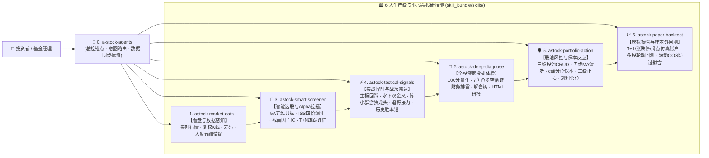

# SPEC-SKILL-002：A股生产级投研技能「1 + 6」物理精简与极速测试体系重构规范

- **文档编号**：`SPEC-SKILL-002`
- **制定日期**：2026-10-19
- **当前状态**：📋 **架构定版（待批准执行）**
- **前置审计**：[`docs/audits/2026-10-19-skill-comprehensive-evaluation-and-governance-audit.md`](../../audits/2026-10-19-skill-comprehensive-evaluation-and-governance-audit.md)
- **关联规范**：
  - [`AGENTS.md`](../../../AGENTS.md)（工作区规则、实战交易三原则、空池处理、测试分层规约）
  - [`docs/guidelines/engineering/skill-suite-portability-specification.md`](../../guidelines/engineering/skill-suite-portability-specification.md)（锚点技能与多宿主交付规范）
  - [`docs/guidelines/engineering/testing-guide.md`](../../guidelines/engineering/testing-guide.md)（测试工程指南）

---

## 一、重构背景与核心设计原则

### 1.1 核心痛点回顾
1. **技能粒度过碎、用户认知过载**：原架构包含 `1 + 19` 共 20 个平级技能入口，将内部算法步骤（如单独的 HTML 渲染、归档、路由、静态避坑文本、单一 MACD 金叉）全部暴露为一等技能，导致用户与智能体选型困难，且存在 3 项 L2 协议壳技能与 7 处工程契约断层（G1–G7）。
2. **测试套件臃肿、门禁耗时过长**：原测试套件收集 **718 例 Python 用例 + 30 个前端 Node.js 脚本 + 16 例浏览器 E2E**，其中 P0 核心门禁（`-m core` 358 例）在 Windows 下耗时高达 **135s–317s**（主要被 102 例重型跨平台打包解压、子进程 CLI 冷启动及混入的服务端用例拖慢），严重阻碍投研算法与技能的敏捷迭代。

### 1.2 重构决策与四大设计目标
根据最新架构决策，正式确立以下两大重构铁律：
1. **技能架构采用「方式 A：物理精简为 `1 + 6` 生产级股票投研技能」**：
   - 将 `skill_bundle/skills/` 从 20 个目录**物理收敛为 7 个目录**（`1` 个总入口锚点技能 + `6` 个高内聚生产级专业股票投研技能）；
   - 遵循专业机构股票投研全链路闭环（**看盘知势 $\to$ 选股立池 $\to$ 择时定买 $\to$ 穿透体检 $\to$ 仓位风控 $\to$ 回测验证**），打造**功能准确、可循证、高可靠、策略有效、分析面全且核心观点突出**的生产级投研技能；
   - 底层 `skill_bundle/runtime/core/` 整合为 **6 大确定性技术支撑引擎**，对上通过统一的 CLI 与 `TOOL_MAP` 提供毫秒级确定性计算。
2. **测试架构全面瘦身与解耦重构**：
   - **彻底移除前端界面测试**：删除 `tests/frontend/`（30 个 DOM/JS 脚本）与 `tests/browser/`（Edge 浏览器 UI 验收），前端界面不再纳入自动化测试范围；
   - **WebUI 后端 API 测试独立分仓**：将 `apps/web-console/backend/` 相关的 FastAPI 路由、鉴权、会话、SSE 测试完全剥离至独立的 WebAPI 测试专集（`-m webapi`），与投研技能核心测试物理隔离，另行设计维护；
   - **重塑极速核心门禁（目标耗时 `< 8 秒`）**：默认核心门禁（`-m core`）仅聚焦 `1 + 6` 投研技能契约与 `6` 大底层量化引擎的纯内存确定性测试；重型打包发布测试剥离至独立的 `-m release_pack` 门禁（仅在修改打包/安装器时按需触发）。

---

## 二、「1 + 6」生产级股票投研技能体系设计（物理精简方案 A）

### 2.1 专业股票投研全工作流映射

专业股票投研机构的标准实战闭环包含六个核心环节，严格一一对应重构后的 **6 大专业投研技能**，加上 **1 个总入口与运维锚点技能**，构成 `1 + 6` 黄金矩阵：



### 2.2 `1 + 6` 物理目录结构与原 20 技能收编映射表

重构后，`skill_bundle/skills/` 下**仅保留以下 7 个物理文件夹**，原 19 个业务技能的能力、参考手册与工具入口被 100% 无损吸收并升级：

| 新序号 | 新物理目录名 (`skill_bundle/skills/`) | 投研职能定位 | 物理吸收与合并的原技能 (20 $\to$ 7) | 统一 CLI 主入口 (`astock <cmd> --json`) |
| :---: | :--- | :--- | :--- | :--- |
| **0** | **`a-stock-agents`** | **总入口锚点 · 意图路由 · 系统与数据运维** | • `a-stock-agents` (原总入口)<br>• `astock-meta-routing` (动态意图路由)<br>• `astock-knowledge-tips` (全局风控与避坑内化) | `astock intent --query "<文本>"`<br>`astock data sync / daemon / dataset`<br>`astock doctor` |
| **1** | **`astock-market-data`** | **全景行情、技术筹码与大盘五维情绪中枢** | • `astock-data-feed` (行情/K线/指标/筹码/事件)<br>• `astock-platform-evaluate` 中的 `market` (大盘五维健康度与情绪门控) | `astock data quote / kline / tech / cyq / events <代码>`<br>`astock market [代码]` |
| **2** | **`astock-deep-diagnose`** | **个股全维循证诊断、7角色多空研判与研报交付** | • `astock-platform-evaluate` (`evaluate` / `trapped`)<br>• `astock-agent-debate` (7角色多空对抗证据链)<br>• `astock-report-html` (单文件自包含交互报告)<br>• `astock-report-archive` (单股/多股联合归档) | `astock diagnose <代码> [--cost <成本> --shares <股数>] [--debate] [--html]`<br>*(兼容别名：`evaluate`, `debate`, `report`, `trapped`)* |
| **3** | **`astock-smart-screener`** | **智能漏斗选股、5A主线共振与截面Alpha中心** | • `astock-screener-5a` (五维共振与五大财务排雷)<br>• `astock-selection-model` (ISS条件树/漏斗/版本/调度/T+N跟踪)<br>• `astock-quant-engine` (截面因子清洗/MAD/Z-Score/滚动IC) | `astock screen [--mode 5a\|funnel\|quant] ...`<br>`astock funnel validate / run / daemon`<br>`astock screen-model assess / track / evaluate / tune` |
| **4** | **`astock-tactical-signals`** | **A股实战战法识别与买点信号雷达（带胜率锚）** | • `astock-strategy-mainboard` (主板波段回踩/均值回归/网格)<br>• `astock-strategy-macd` (水下二次金叉真实波谷识别)<br>• `astock-strategy-chenxiaoqun` (游资深水/弱转强/中军/首阴)<br>• `astock-strategy-tuige` (**补齐纯Python涨停回踩/首阴量化规则**) | `astock signal <代码> [--tactic all\|mainboard\|macd\|chenxiaoqun\|tuige]`<br>*(兼容别名：`pattern macd/chenxiaoqun`, `strategy swing`, `shortline check`)* |
| **5** | **`astock-portfolio-action`** | **三级股池治理、精确保本精算与盘中反应动作中枢** | • `astock-action-execution` (`ceil`保本价/三级止损/三场景反应单)<br>• `astock-pool-dashboard` (关注/自选/持仓三级池CRUD+通达信导出)<br>• `astock-pool-audit` (**补齐五步真实MA重算与失效止损清洗**)<br>• `astock-quant-engine` (目标波动率受限凯利头寸管理) | `astock action <代码> --cost <成本> --shares <股数>`<br>`astock pool list / add / remove / audit / tdx`<br>`astock position-risk` |
| **6** | **`astock-paper-backtest`** | **高保真A股模拟盘与样本外回测检验中心** | • `astock-trade-paper` (T+1/涨跌停/分位滑点/SQLite多账户模拟撮合)<br>• `astock-screener-5a` 中的 `backtest-multi` (多股轮动回测)<br>• `astock-model-validation` (**补齐滚动样本外OOS与过拟合三重检验**) | `astock trade balance / positions / buy / sell / history`<br>`astock backtest <代码或组合> [--oos]` |

---

## 三、生产级股票投研五大质量标准与落地规格

为确保 `1 + 6` 技能达到**专业机构生产级投研水准**，每个技能从底层返回 Schema 到上层呈现必须强制执行以下五大质量标准：

### 3.1 准确性与可循证性（EvidenceEnvelope 强制溯源信封）
- **零幻觉与零估算铁律**：严禁大模型口算均线、手算税费或凭记忆编造股价。
- **统一数据溯源信封 (`evidence_meta`)**：所有 6 大技能的 JSON 输出顶部必须携带标准循证元数据：
  ```json
  "evidence_meta": {
    "as_of_trading_day": "2026-10-19",
    "quote_source": "L1:tencent_realtime",
    "kline_bars_count": 250,
    "watermark_ready": true,
    "fee_rule_ssot": "stamp_0.0005_comm_0.00025_min5_ceil"
  }
  ```
- **多空双向证据链**：在 `astock-deep-diagnose` 中，任何看多/看空结论必须同时列出 **Top 3 看多实证（含具体指标数值与分位）** 与 **Top 3 风险证伪条件（含财务排雷项与关键跌破位）**。

### 3.2 可靠性与失败关闭（Fail-Closed & Four-Tier Resilience）
- **行情 4 级自动降级**：`L1 腾讯实时/日K` $\to$ `L2 东方财富` $\to$ `L3 新浪财经` $\to$ `L4 本地 Parquet/CSV 水位快照`。
- **数据不足即刻拒绝（Fail-Closed）**：K 线不足 60 根、停牌或核心字段缺失时，底层直接返回 `status: "error", code: "DATA_UNAVAILABLE"`；空股池查询时立即终止并提示登记格式（`股票:股数@成本价`），绝不降级为伪造演示数据。

### 3.3 策略有效性与历史胜率锚定（Contextual Win-Rate Anchor）
- **拒绝孤立形态喊单**：在 `astock-tactical-signals` 中，每当识别出「水下二次金叉」「主板缩量回踩」「陈小群弱转强」或「退哥龙头首阴」信号时，底层自动调用 `StrategyEvaluator` 对该股过去 250 个交易日同类买点进行毫秒级回溯，**随信号强制附带历史样本数、T+5 胜率、平均盈亏比与最大回撤**。
- **双重门控过滤**：所有买点信号必须通过 **① 大盘情绪门控（`MarketAssessor < 40` 分冰点期自动熔断右侧追高信号）** 与 **② 45bps 冲击成本门槛（预期波段空间低于交易摩擦成本 3 倍时直接过滤）**。

### 3.4 分析面全覆盖（六维正交投研矩阵）
`astock-deep-diagnose` 与 `astock-smart-screener` 强制覆盖股票投研完整六维：
1. **宏观与大盘情绪面**：五维大盘健康度（趋势/情绪/量能/结构/资金）与主线板块共振度；
2. **基本面与财务排雷**：ROE、营收/净利增速、商誉占比、质押率、经营现金流、ST/退市风险一票否决；
3. **技术趋势与动能面**：均线多头排列度、MACD 零轴与波谷背离、RSI/KDJ 极值、ATR 真实波幅；
4. **量价与筹码结构面**：量比、换手沉淀、筹码获利比例（`winner_rate`）、90% 筹码集中度、主力资金净流入；
5. **游资与微观博弈面**：封板质量、炸板率、连板梯队身位、龙虎榜席位溢价；
6. **风控与头寸精算面**：`math.ceil` 精确到分保本卖出价、`-3%/-5%/-8%` 三级止损位、受限凯利建议仓位。

### 3.5 核心观点突出（金字塔结论先行范式）
所有技能输出严禁“堆砌指标流水账”，必须遵循 **金字塔结构（BLUF - Bottom Line Up Front）**：
1. **第一屏【核心结论卡】**：综合评级（`S / A / B / C / D`）、100 分制得分、大盘情绪灯号、**一句话核心投研观点（含触发价与证伪位）**；
2. **第二屏【实战交易三原则动作单】**：精确到分 `math.ceil` 保本卖出价 + T0/T1/T2 三级止损价格表 + 冲高/震荡/急跌三场景条件单；
3. **第三屏【六维循证数据表与多空证据链】**：结构化支撑论据，供深度下钻。

---

## 四、底层 6 大技术支撑引擎规划（`skill_bundle/runtime/core/`）

底层 `runtime/core/` 作为后台确定性工厂，按职责收敛为 **6 大技术支撑引擎**，支撑上层 `1 + 6` 技能并彻底修复前期审计发现的 G1–G7 断层：

| 引擎编号 | 技术支撑引擎名称 | 归属代码包 (`runtime/core/`) | 关键支撑职责与本次升级闭合点 |
| :---: | :--- | :--- | :--- |
| **Engine A** | **多源数据同步、盘中切片与水位门禁引擎** | `core/data/` | • 4 级行情容灾获取（`data_bridge.py`）与全市场增量同步（`sync_engine.py`, `dataset_sync.py`）<br>• 盘中分钟级归档去重（`intraday_archiver.py`）与选股前置水位门禁（`data_assembler.py`） |
| **Engine B** | **技术指标、截面因子与财务排雷引擎** | `core/indicators/`<br>`core/models/` | • 纯 Python 向量化指标库（`technical_indicators.py`）与 15+ 量价/非结构化因子（`pv_factors.py`, `unstructured_factors.py`）<br>• 截面 MAD 去极值 + Z-Score 标准化（`factor_synthesizer.py`）+ 五大基本面硬排雷（`fundamental_filter.py`） |
| **Engine C** | **智能选股漏斗编译、版本仓库与跟踪评估引擎** | `core/selection_models/`<br>`core/strategy/funnel_engine.py` | • **单内核统一**：将 `5A`、`quant` 与 `ISS` 统一收敛至 AST 条件树与四阶段漏斗引擎（`model_compiler.py`）<br>• 模型 SHA256 版本仓库（`version_repository.py`）与 T+1/T+3/T+5/T+10 自动递进跟踪评估（`tracking_service.py`） |
| **Engine D** | **实战战法识别、税费精算与三级股池风控引擎** | `core/strategy/` | • **修复 G1/G2/G3/G6**：打通 `second_golden_cross` 真实波谷识别、实现 `tuige.py` 涨停回踩/首阴算法、实现 `pool_manager.py` 五步真实 MA 重算与止损越界审计<br>• 二分法 + `math.ceil` 保本价精算（`execution_action_engine.py`）与受限凯利头寸管理（`risk_position_manager.py`） |
| **Engine E** | **A股仿真撮合、多股回测与样本外检验引擎** | `core/paper_trading/`<br>`core/models/strategy_evaluator.py` | • T+1 冻结、10%/20%/5% 涨跌停封板拦截、分位滑点与 SQLite 多账户撮合（`engine.py`）<br>• **修复 G6**：内建滚动样本外（Rolling OOS）评估与过拟合三重警报（`Sharpe > 3.5` / `WinRate > 75%` / `IS-OOS 衰减 > 50%`） |
| **Engine F** | **交易日历网关、自包含报告渲染与安全沙箱引擎** | `core/monitor/`<br>`core/reporting/`<br>`core/governance/` | • **修复 G4/G5**：`tools.py` 动态接入 `IntentEvaluator`；统一 `report_generator.py` 费率与三级止损口径<br>• `SkillRegistry` 统一管理 `1 + 6` 规范技能 ID，同时在 `LEGACY_SKILL_ALIASES` 中兼容旧 19 技能别名调用 |

---

## 五、测试体系重构规划（极速核心 · WebAPI 独立 · 零前端测试）

### 5.1 原测试体系耗时与痛点剖析
当前 `tests/` 共收集 **718 例 Python 用例 + 30 个 Node.js 前端脚本 + 16 例浏览器 E2E**：
- **前端与浏览器测试冗余**：`tests/frontend/`（30 个 JS 脚本，静态正则/DOM 模拟）和 `tests/browser/`（16 例 Edge 浏览器登录验收）维护成本高且不在投研核心边界内；
- **WebUI 后端测试与量化核心混杂**：`tests/server/`（20 个文件 / 195 例）与 `tests/core/` 混在同一个 `conftest.py` 顶层会话生命周期内，每次加载 FastAPI 单例与鉴权数据库；
- **P0 核心门禁被重型打包测试拖慢**：`tests/core/test_release_delivery_gate.py` 单文件含 **102 例**跨平台 zip 打包、沙箱解压、子进程 `.venv` 探测与安装脚本测试，导致 `-m core` 耗时高达 **135s–317s**。

### 5.2 新测试体系三大重构原则
严格遵循用户指令：
1. **前端界面零测试（Zero Frontend UI Tests）**：
   - **物理移除** `tests/frontend/`（全部 30 个 `.js` 测试脚本）与 `tests/browser/`（浏览器 E2E 目录及 `test_browser_e2e_security.py`）；
   - 移除 `conftest.py` 中的 `browser_e2e` 收集钩子与 `pyproject.toml` 中的 `browser-test` 冗余依赖。
2. **WebUI 后端部分另行独立设计（Standalone WebAPI Test Suite）**：
   - 将所有与 Web 控制台后端（`apps/web-console/backend/server/`）相关的测试独立归入 `tests/webapi/`，打上专属 `@pytest.mark.webapi` 标签；
   - **默认跑技能与量化测试时绝不收集或触发 `webapi`（也不初始化 FastAPI TestClient 与 SQLite 会话库）**；
   - `tests/webapi/` 重构为精简高内聚的 4 个契约测试文件（详见 5.4 节），仅在修改 `apps/web-console/backend/` 时通过 `pytest -m webapi` 专项执行。
3. **投研技能与核心引擎测试极速化（Fast Core Gate `< 8 秒`）**：
   - 围绕 **`1 + 6` 专业投研技能 + `6` 大底层技术引擎**重新组织 `tests/core/` 与 `tests/skills/`；
   - 将总用例数从 **718 例精简收敛至 ~160 例高价值确定性断言**；
   - 将重型打包与安装器子进程测试移入独立的 `tests/release/`（标记为 `-m release_pack`），使日常研发 P0 核心门禁（`pytest -m core`）从 **135s–317s 压缩至 `< 8 秒`**！

### 5.3 重构前后的测试规模与耗时对比

| 维度 | 重构前（现状） | 重构后（新架构目标） | 优化幅度 |
| :--- | :--- | :--- | :--- |
| **前端界面测试 (`tests/frontend/` & `tests/browser/`)** | 30 个 JS 脚本 + 16 例浏览器 E2E | **0 例（彻底移除，无需设计前端测试）** | **-100%** |
| **P0 默认核心门禁 (`pytest -m core`)** | 358 例，耗时 **135s – 317s** | **~110 例纯内存确定性测试，耗时 `< 8s`** | **提速 ~25–40 倍** |
| **技能契约与治理测试 (`tests/skills/`)** | 散落在 10 个治理文件 / 92 例 | **聚焦 `1 + 6` 技能契约与真实性，~25 例，`< 2s`** | **精准聚焦 `1+6`** |
| **WebUI 后端专项测试 (`pytest -m webapi`)** | 20 个文件 / 195 例（混在 p1/core） | **独立分仓 `tests/webapi/`，4 个核心文件 / ~35 例，`< 6s`** | **物理隔离、按需单跑** |
| **发布打包专项门禁 (`pytest -m release_pack`)** | 混在 `core` 中每次必跑（102 例） | **独立分仓 `tests/release/`，~20 例核心打包冒烟，仅发版前跑** | **彻底解除日常阻塞** |

### 5.4 新测试目录结构蓝图 (`tests/`)

```text
tests/
├── conftest.py                         # 极速轻量基座：仅初始化隔离临时目录与 core/skills/webapi/release_pack 四档标记
│                                       # （不再在顶层无条件导入 FastAPI server）
├── README.md                           # 新版极速测试架构与门禁指南
│
├── core/                               # 【档位：core】6 大底层技术支撑引擎纯内存单元测试（6 文件 / ~85 例，耗时 < 5s）
│   ├── test_engine_a_data_sync.py      # Engine A: QuoteDict 别名、4级降级桩、增量落盘、分钟归档与水位门禁
│   ├── test_engine_b_factors_tech.py   # Engine B: MA/MACD/KDJ/RSI/BOLL/ATR、MAD+ZScore合成、五大财务排雷
│   ├── test_engine_c_funnel_iss.py     # Engine C: AST条件树编译、四阶段漏斗、模型版本SHA256、调度锁与T+N跟踪
│   ├── test_engine_d_tactics_risk.py   # Engine D: 二分+ceil分位保本价、三级止损、三场景反应单、凯利仓位、四大战法与五步股池MA审计
│   ├── test_engine_e_paper_backtest.py # Engine E: T+1冻结、涨跌停拦截、分位滑点撮合、多股轮动回测、滚动OOS与过拟合三重警报
│   └── test_engine_f_infra_safety.py   # Engine F: 交易日历开闭市状态机、三桶路径隔离、HTML报告XSS转义与费率SSOT一致
│
├── skills/                             # 【档位：core】「1 + 6」生产级投研技能契约与端到端工具网关测试（2 文件 / ~25 例，耗时 < 3s）
│   ├── test_skill_suite_1plus6_contract.py # 校验 1+6 物理目录、SKILL.md frontmatter、skills_manifest.json、无死链与旧别名兼容
│   └── test_skill_tools_execution.py       # 校验 1+6 技能在 CLI 与 TOOL_MAP 下的真实调用、EvidenceEnvelope 信封、空池拦截与实战三原则输出
│
├── webapi/                             # 【档位：webapi】WebUI 后端 API 独立测试专集（另行独立设计，与前端 UI 无关，4 文件 / ~35 例）
│   ├── conftest.py                     # 仅在运行 tests/webapi/ 时按需加载 FastAPI app / client / anon_client
│   ├── test_webapi_auth_and_session.py # 登录鉴权、Bearer Token、RBAC 权限、会话 CRUD 与记忆隔离
│   ├── test_webapi_market_and_sync.py  # 行情 REST API、数据同步设置持久化、股池导入预览/提交契约
│   ├── test_webapi_selection_api.py    # 智能选股模型 API、阶段 E 跟踪评价接口与 SSE 流式状态契约
│   └── test_webapi_agent_dispatch.py   # Web Agent 对 1+6 技能工具的调度、LLM 就绪检查与凭证脱敏安全
│
└── release/                            # 【档位：release_pack】发布打包与宿主安装按需门禁（仅修改 packaging/install 时执行，1 文件 / ~20 例）
    └── test_release_packaging_smoke.py # 1+6 锚点打包、Zip Slip 防护、三级寻址、install.ps1/sh 沙箱探测与 doctor 自检
```

### 5.5 WebUI 后端测试（`tests/webapi/`）另行设计规范
针对用户提出的「关于 webui 部分另行设计测试用例，前端界面无需设计测试用例」，制定以下边界契约：
1. **严格限定在后端 HTTP/SSE/DB 契约层**：
   - 只测试 `apps/web-console/backend/server/` 暴露的 FastAPI 路由（`/api/auth/*`, `/api/chats/*`, `/api/market/*`, `/api/data-sync/*`, `/api/selection-models/*`, `/api/models/*`）；
   - **完全不测试**任何 `.html`、`.css`、`apps/web-console/frontend/` 下的 JavaScript 渲染逻辑、DOM 节点或浏览器截图。
2. **Fixture 懒加载与零耦合**：
   - 将 `app`、`auth_headers`、`client`、`anon_client` 从根 `tests/conftest.py` 迁移至 `tests/webapi/conftest.py`；
   - 当开发者执行 `pytest -m core` 验证投研技能与量化算法时，Python 进程根本不会导入 `fastapi`、`uvicorn` 或 `server.app`，启动开销趋近于 0。
3. **合并冗余文件（20 个文件 $\to$ 4 个高内聚模块）**：
   - 原 `tests/server/` 下有 20 个零散测试文件（包含大量历史单次 bug 修补文件如 `test_access_and_thought_fix.py`、`test_agent_tool_technical_summary.py` 等），统一按后端四大业务域重构为 4 个结构化测试模块（鉴权会话、行情同步、选股接口、智能体分发），消除重复构造数据的开销。

---

## 六、分时原子执行计划与看板链接（Execution Plan & Kanban）

本规范的具体工程落地由以下两份分时实施计划与看板驱动执行（严格执行 `[▶]` $\to$ `[🚧 IN_PROGRESS: <session_id> | <时间>]` $\to$ `[x]` 原子排他协议）：
- **主实施计划（任务矩阵与验收台账）**：[`docs/specs/engineering/eng-skill-1plus6-and-test-rearchitecture-plan.md`](eng-skill-1plus6-and-test-rearchitecture-plan.md)（任务编号：`S2-01` ~ `S2-10`）
- **分时原子执行看板**：[`docs/specs/engineering/delivery-execution-roadmap.md`](delivery-execution-roadmap.md)（顺序 ⑫ ~ ㉑）

| 阶段 | 任务范围 | 步骤与核心任务 | 涉及路径 | 预期验证方式与耗时 |
| :---: | :---: | :--- | :--- | :--- |
| **Phase 1** | `S2-01` ~ `S2-03` | **底层 6 大支撑引擎缺口闭合（修复 G1–G7）**<br>1. `S2-01`：统一 `EvidenceEnvelope` 溯源信封，打通 `tools.py` 真实 `second_golden_cross` 与 `IntentEvaluator`，修复 CLI `action` 参数契约；<br>2. `S2-02`：新增 `core/strategy/tuige.py`（涨停回踩/首阴接力算法）并内建 250 日同类信号历史胜率锚定；升级 `pool_manager.py` 实现五步真实 MA 重算与止损越界审计；<br>3. `S2-03`：升级 `backtest_cmds.py` 补齐滚动样本外（Rolling OOS）与过拟合三重警报；统一 `report_generator.py` 税费与三级止损口径。 | `skill_bundle/runtime/core/` | 定向单元测试前台秒级通过 |
| **Phase 2** | `S2-04` ~ `S2-07` | **「1 + 6」投研技能物理合并与契约升级**<br>1. `S2-04`：构建 `astock-market-data`、`astock-smart-screener`、`astock-tactical-signals` 三大投研技能物理目录；<br>2. `S2-05`：构建 `astock-deep-diagnose`、`astock-portfolio-action`、`astock-paper-backtest` 及升级总控 `a-stock-agents`；<br>3. `S2-06`：物理移除旧 19 个零散技能目录，更新 `skills_manifest.json`、`SkillRegistry`（含 `LEGACY_SKILL_ALIASES` 19 项旧别名兼容）、`cli.py`、`tools.py`、`doctor.py`；<br>4. `S2-07`：同步更新打包器 `common.py`/`publish_release.py`、安装器 `install.ps1`/`install.sh` 及全仓文档口径（`1 + 6 = 7` 入口）。 | `skill_bundle/skills/`<br>`skill_bundle/assets/config/skills_manifest.json`<br>`skill_bundle/runtime/`<br>`tools/packaging/`<br>`AGENTS.md` | `python skill_bundle/runtime/doctor.py --json` 实测 `is_healthy: true` (`total_skills: 7`, `business_skills: 6`) |
| **Phase 3** | `S2-08` ~ `S2-10` | **极速测试体系重构与 WebAPI 独立分仓**<br>1. `S2-08`：物理移除 `tests/frontend/` 与 `tests/browser/`，将 WebUI 后端测试独立剥离至 `tests/webapi/`（4 个高内聚模块，专属 `-m webapi` 与懒加载 fixture）；<br>2. `S2-09`：重构 `tests/core/`（6 大引擎纯内存单测）与 `tests/skills/`（`1+6` 契约、六步投研闭环符合性与执行测试），将重型打包移入 `tests/release/`（`-m release_pack`）；<br>3. `S2-10`：升级 `tests/conftest.py`、`tools/validation/check.py`、`tests/README.md` 并执行全链路前台顺序验收。 | `tests/`<br>`tools/validation/check.py` | 前台顺序执行：<br>① `pytest -m core` (`< 8s`, 0 failed)<br>② `pytest -m webapi` (`< 6s`, 0 failed) |

---

## 七、后续新增或改动技能强制符合性评估标准（Conformance Assessment Gate）

自本规范生效起，任何针对技能或投研算法的新增与修改，必须严格遵循 [`docs/guidelines/engineering/skill-suite-portability-specification.md`](../../guidelines/engineering/skill-suite-portability-specification.md) 第 9 章定义的 **「专业机构股票投研六步全链路闭环（看盘知势 $\to$ 选股立池 $\to$ 择时定买 $\to$ 穿透体检 $\to$ 仓位风控 $\to$ 回测验证）」**，并逐项通过 **C1~C6 六维符合性评估门禁**（详见该规范 §9.4）。任何破坏 `1 + 6` 物理边界、缺失 `evidence_meta` 溯源信封、缺失历史胜率锚定或违背实战交易三原则的改动一律不予准入。

