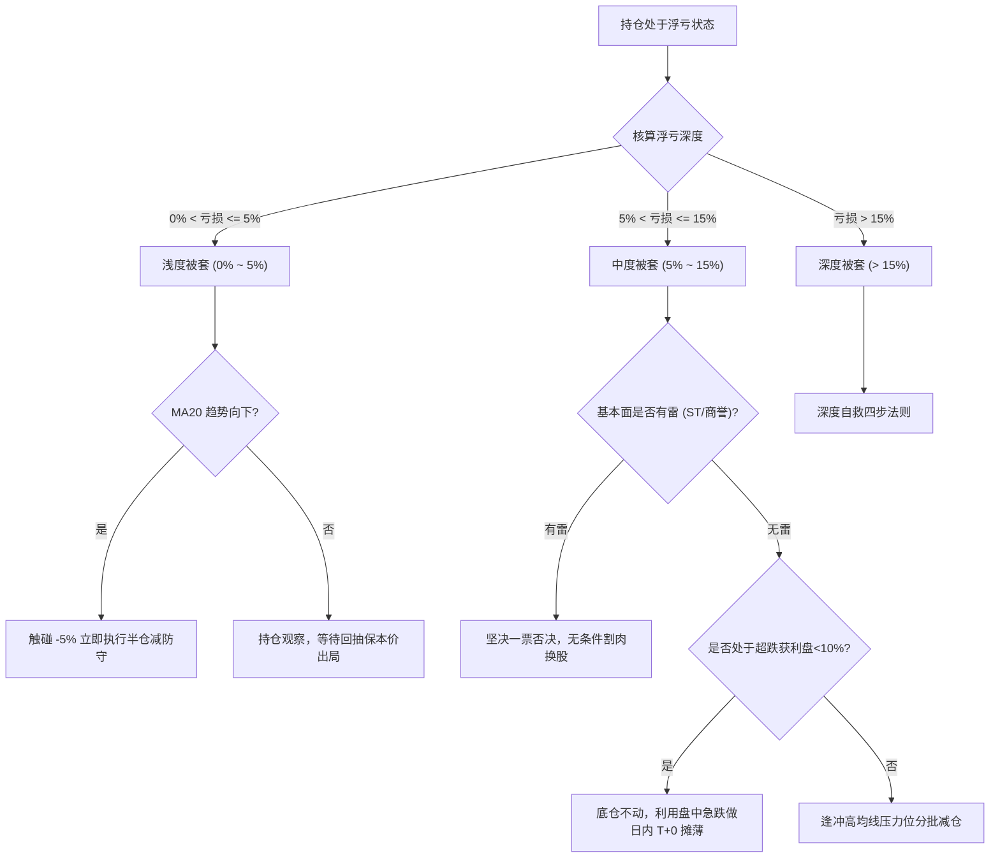

# 被套持仓分级自救与解套决策树

## 1. 被套诊断分级评估

当持仓发生亏损时，系统依据亏损深度、大盘周期与个股趋势进行三级分类：

---

## 2. 深度被套四步救赎法则

对于浮亏超过 15% 的重套标的，严禁盲目大举加仓抄底，必须按以下步骤推进：

1. **第一步：券商 FIFO 成本陷阱复核**
   - 识别券商是否按先进先出法将补仓卖出后的剩余筹码重置为历史极高成本；
   - 准确按总投入本金、当前市值、累计已实现盈亏与实际持股数，重算“真实加权保本价”。
2. **第二步：基本面一票否决排查**
   - 若出现业绩连续巨额亏损、实控人立案调查、无法按期披露年报或披星戴帽，坚决出局，切勿对财务造假抱有幻想。
3. **第三步：波段阻力位测算**
   - 计算上方密集套牢筹码峰（90% 筹码阻力带）与 MA60/半年线压制位；
   - 明确反弹第一目标位，设定逢高减亏换仓节点。
4. **第四步：微量底仓日内网格做 T**
   - 严禁动用超过总资金 20% 的现金救火；
   - 仅在分时急跌偏离均价线 $>2.5\%$ 且水下出现双金叉底背离时低吸，冲高回落时即刻卖出对应数量，降低综合持仓成本。
