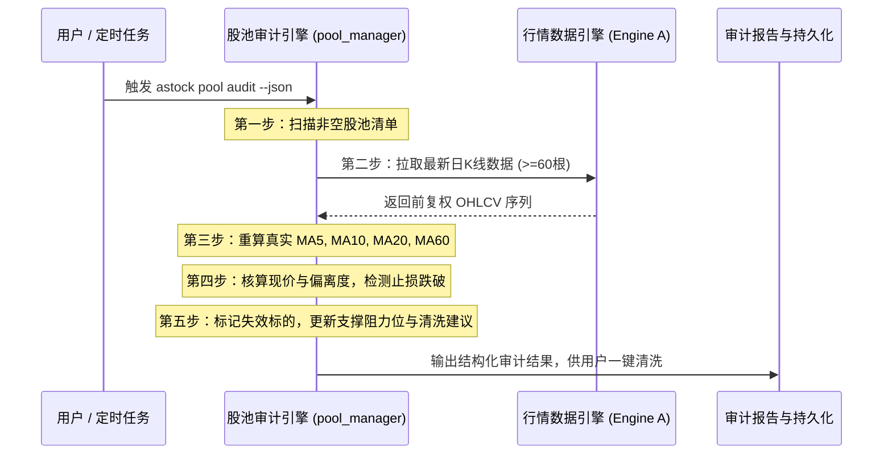

# 股票池五步真实 MA 重算与失效止损清洗算法

## 1. 核心问题背景

静态股票池若长期不维护，会导致：
- 记录的价格与关键均线脱节；
- 个股跌破止损位后未及时告警出池；
- 股价大幅偏离均线（如均线乖离率 $>15\%$）导致回踩风险陡增。

因此，系统内置 `astock pool audit` 命令，执行全自动五步真实 MA 审计与失效标的清洗。

---

## 2. 五步真实 MA 重算流程

1. **第一步（扫描股池）**：读取关注池、自选池与持仓池中的全部非空标的记录；
2. **第二步（拉取日 K）**：调用底层行情引擎拉取最新日 K 序列（确保至少包含 60 个交易日）；
3. **第三步（重算真实均线）**：通过纯 Python 向量化算法精确计算当天的 `MA5`、`MA10`、`MA20`、`MA60`；
4. **第四步（止损与偏离检测）**：
   - **止损跌破检测**：现价跌破持仓成本 $-5\%$ 或已设定的关键止损位，标记为 `breached_stops`；
   - **均线极端偏离检测**：现价相对 MA20 乖离率 $\text{BIAS20} > 15\%$ 或 $<-15\%$，标记为极端偏离；
   - **过期停牌检测**：超过 30 个交易日未更新成交或已停牌标的，标记为 `stale_records`；
5. **第五步（建议与清洗输出）**：输出更新后的均线支撑阻力位，并提供推荐清洗/移出清单。
