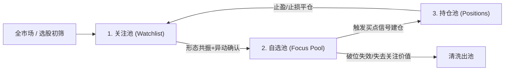

# 三级股票池生命周期管理与空池 Fail-Closed 规范

## 1. 三级股票池生命周期

投研系统将用户的标的管理划分为严格的三个层级，形成动态流动闭环：

1. **关注池 (`watchlist`)**：中长线跟踪标的、行业白马与备选雷达；
2. **自选池 (`focus`)**：近期处于多头趋势、临近突破买点或战法触发的高优先标的；
3. **持仓池 (`positions`)**：当前账户实际真金白银持有的标的，记录持仓数量、买入成本与开仓时间。

---

## 2. 物理存储与数据隔离规范

所有股池数据严格落盘于用户私有数据根下的 `output/pools/`，与代码完全隔离：
- `output/pools/watchlist.csv`
- `output/pools/focus.csv`
- `output/pools/positions.csv`
- 支持一键导出通达信自选股格式（`.blk` / `.txt`），实现与看盘软件的无缝同步。

---

## 3. 空池即刻终止与登记格式指引 (Fail-Closed)

当用户发起股票池分析、持仓诊断或盘中风控巡检时，系统必须严格遵守以下守则：

1. **真实读取数据**：通过统一命令 `astock pool list --json` 读取本地股池；
2. **空数据即刻终止分析**：若股池记录为空，**严禁臆测、虚构股票代码、或擅自推荐替代股票**；
3. **直接友好提示登记格式**：
   - **持仓股登记**：`股票代码:持股数@成本价`（例如：`000001:1000@12.50`）；
   - **关注/自选股登记**：直接输入股票代码或名称（例如：`000001`、`600519`）。
